# Arquitectura de ConciliaRH

> Visión general de la arquitectura (base, seguridad, cola de trabajos).

## 1. Vista general

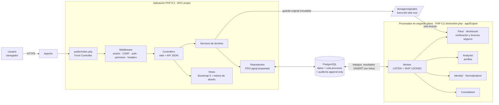

**Principios:**
- PHP **nunca** ejecuta comandos del sistema. Encola un trabajo (`INSERT` + `NOTIFY`) y consulta su estado.
- El procesador en segundo plano (worker PHP, `bin/worker.php`) **nunca** recibe texto libre del usuario. Recibe IDs y parámetros tipados desde la base de datos.
- PostgreSQL es la **única fuente de verdad**: datos, estados de proceso, auditoría y configuración.
- Los originales son inmutables y se identifican por su SHA-256.

## 2. Flujo de importación

> **FASE 2 implementada:** carga → validación → almacenamiento inmutable → `VERIFICAR_ARCHIVO`. El detalle vigente (rutas, estados, compensación, límites y códigos de error) está en **`docs/IMPORTS.md`**. El diagrama siguiente es el flujo objetivo completo. Hay dos diferencias con lo implementado: el original se guarda en `imports/{periodo}/{lote}/{uuid}/original.{ext}` y no por hash, y un duplicado exacto en otro lote se registra enlazado (`DUPLICADO_BINARIO`) con confirmación, en lugar de ignorarse.

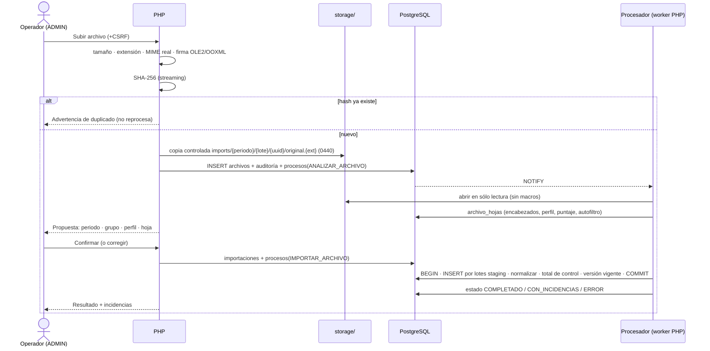

## 3. Flujo de conciliación

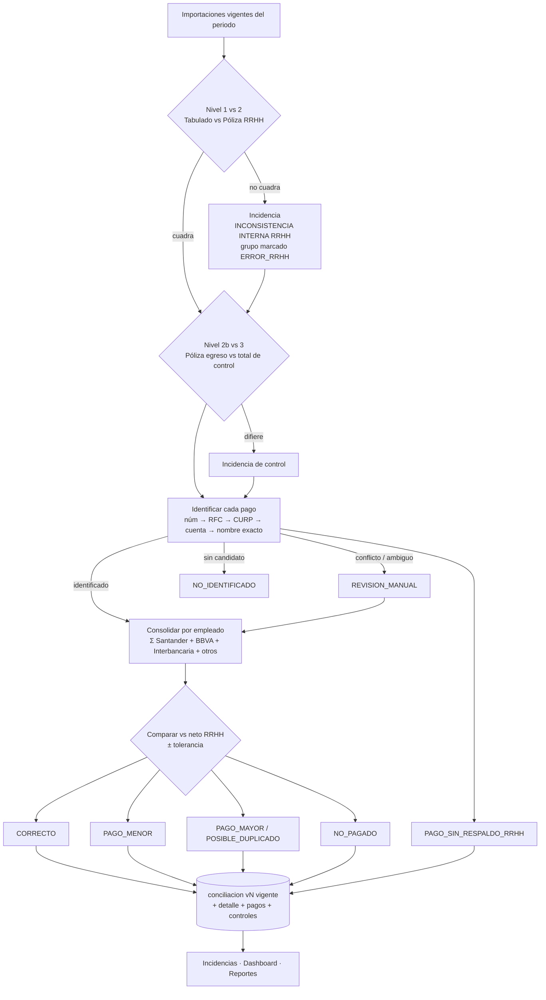

> **Implementado en la FASE 5** (`docs/CONCILIATION_ENGINE.md`).
> - Por lote: selección de archivos → niveles 1, 3, 2, 4 y 5 → totales → incidencias.
> - Lo pendiente de identidad se reporta aparte y nunca se asigna.
> - Sólo el cálculo final vive en el motor del procesador (`app/Engine/Conciliation`); la web orquesta y muestra.

La **conciliación de pensiones** sigue el mismo patrón con otras fuentes:
- **Retención:** conceptos marcados `es_pension`.
- **Dispersión:** archivos de pensiones.
- **Identificación:** número del trabajador obligado o catálogo de beneficiarios.

## 4. Modelo conceptual

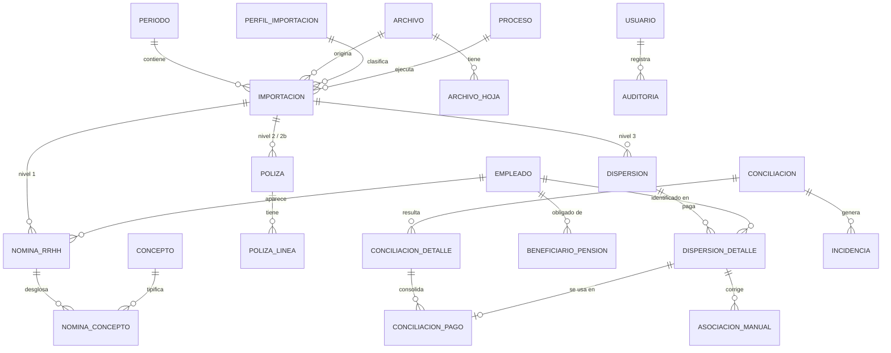

## 5. Entornos

| | Desarrollo | Producción |
|---|---|---|
| Ejecución | `infra/docker/compose.yml` (php-apache, postgres, worker) | Apache + PHP-FPM o mod_php nativos, PostgreSQL nativo, `systemd` para el worker |
| Datos | Ficticios (generados por código) | Reales |
| Debug | `APP_DEBUG=true` | `APP_DEBUG=false` (validado al arrancar) |
| Contenido | Repositorio completo | Paquete generado por `scripts/build-release.sh` **sin** `.git`, `infra/`, `tests/`, `notebooks/`, fixtures ni `.env` |

## 6. Cola de trabajos web → PostgreSQL → procesador

> Implementada y probada en la FASE 1 (`app/Domain/Jobs/*`; procesador: `app/Engine/Worker/WorkerQueue.php`, `Worker.php`). Hasta la versión 0.1.0-rc.2 el procesador estaba escrito en Python; ahora es PHP CLI (`bin/worker.php`) con la misma tabla `procesos`, el mismo rol `conciliarh_worker` y el mismo protocolo.
> Decisión confirmada por el usuario. Se mantiene porque las pruebas de concurrencia la validaron.

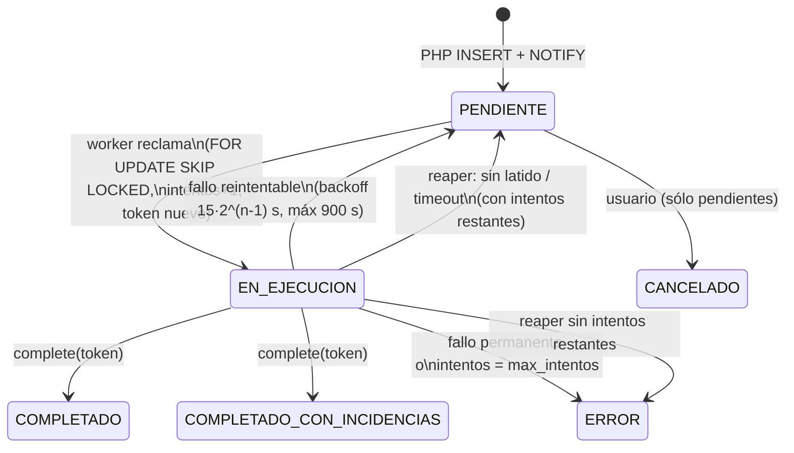

| Responsable | Hace | Nunca hace |
|---|---|---|
| **Web PHP** (`JobQueue`) | Valida el tipo y los parámetros contra el contrato v1 (`JobTypes`), inserta el trabajo (con clave de idempotencia opcional), emite `NOTIFY`, consulta el estado y cancela los pendientes | Ejecutar shell o procesos; escribir resultados (la BD lo impide con privilegios por columna) |
| **PostgreSQL** | Guarda la cola, los estados, el progreso, los intentos, la prioridad, las marcas de tiempo, los errores y la bitácora de eventos. Las restricciones `CHECK` impiden estados incoherentes y reintentos infinitos | — |
| **Procesador** (`app/Engine/Worker/Worker.php`) | Reclama con `SKIP LOCKED`, vuelve a validar el contrato, ejecuta, envía latidos por una conexión lateral propia (en cada `check()`/`progress()` del trabajo), reporta progreso y finaliza o falla **con el token** | Recibir texto libre del usuario; acceder a usuarios o sesiones |

**Concurrencia y recuperación** (cada punto tiene pruebas en `tests/Engine/QueueTest.php` y `WorkerTest.php`):

1. **Exclusión mutua.** `UPDATE … WHERE id = (SELECT … FOR UPDATE SKIP LOCKED LIMIT 1)`. Prueba: 8 procesos compiten por 80 trabajos y cada uno se procesa exactamente una vez.
2. **Lease con fencing.** Cada reclamo genera un `token_bloqueo` UUID nuevo. Latido, progreso, finalización y fallo exigen `token_bloqueo = token AND estado = 'EN_EJECUCION'`. Un worker recuperado ("zombi") no puede escribir nada.
3. **Trabajo abandonado o worker caído.** El reaper (cada 30 s en cada worker, o con `php bin/worker.php reap`; en producción `conciliarh-run worker-reap`) toma los trabajos `EN_EJECUCION` sin latido durante más de `WORKER_HEARTBEAT_TIMEOUT` y los devuelve a `PENDIENTE` con backoff, o a `ERROR` si agotaron sus intentos.
4. **Timeout.** Se controla de dos maneras:
   - **Cooperativo:** el handler recibe el fallo de tiempo agotado (`JobFailure::timeout()`) en su siguiente `progress()` o `check()`.
   - **Forzoso:** el reaper recupera los trabajos que exceden `timeout_segundos`, aunque sigan enviando latidos.
5. **Reintentos acotados.** `intentos` se incrementa al reclamar y la BD exige `intentos <= max_intentos`. Los errores permanentes (`PARAMETROS_INVALIDOS`, `CONTRATO_INVALIDO`) no se reintentan.
6. **Atomicidad con datos de dominio.** `complete()` sobre la conexión de la transacción de dominio permite confirmar los resultados de dominio y la finalización en **la misma transacción**. Si se pierde el lease, se revierte todo.
7. **Errores seguros.** El usuario ve `error_mensaje`. El `error_detalle` técnico (traza recortada y **enmascarada**: cuentas, CURP y RFC) sólo es visible con `procesos.ver_detalle_tecnico`.

**Notificación.** Se usa `LISTEN conciliarh_procesos` con sondeo de respaldo cada `WORKER_POLL_INTERVAL` s, porque un `NOTIFY` perdido no deja trabajos olvidados.

### 6.1 Tipos de trabajo (contrato v1)

| Tipo | Fase | Parámetros | Efecto |
|---|---|---|---|
| `DIAGNOSTICO` | 1 | `eco`, `duracion_segundos` | Prueba de extremo a extremo |
| `VERIFICAR_ARCHIVO` | 2 | `archivo_id` (entero positivo) | Recalcula SHA-256 y tamaño del original, inspecciona el contenedor (descompresión en streaming con topes, XXE, cifrado, VBA) y deja el archivo en `VERIFICADO` o `RECHAZADO`, con auditoría de origen `WORKER`. Idempotente: si el archivo ya está verificado o anulado, no hace nada |
| `ANALIZAR_ARCHIVO` | 3 | `archivo_id` (entero positivo) | Lo encola el **trigger** al quedar VERIFICADO (o PHP al reanalizar / decidir hoja o perfil). Lee el original en sólo lectura, inspecciona todas las hojas, detecta encabezados, perfil, filas TOTAL, controles y huella lógica; persiste el análisis (sustituyendo el anterior) y clasifica la relación con otros archivos. Ver `docs/FILE_ANALYSIS.md` |
| `CONCILIAR_LOTE` | 5 | `conciliacion_id` (entero positivo) | Lo encola PHP tras `fn_solicitar_conciliacion`. Reintenta si el lote tiene archivos en proceso. En una transacción `REPEATABLE READ` lee las importaciones vigentes del lote, calcula con el motor puro (decimal exacto con bcmath), persiste con `INSERT` por lotes los resultados, fuentes, controles e incidencias, y cierra la ejecución con la huella de entradas y sus métricas. Ver `docs/CONCILIATION_ENGINE.md` |
| `NORMALIZAR_REGISTROS` | 4 | `archivo_id`, `completa` (booleano) | Lo encola el **trigger** al cerrar un análisis ANALIZADO* (o PHP a petición). Convierte el staging del análisis vigente en registros definitivos (RRHH, Tesorería, pólizas), asocia cada registro a un empleado con reglas determinísticas, da de alta empleados sólo desde RRHH confiable, registra cuentas por evidencia fuerte, incidencias e historial. Una transacción por archivo; idempotente (sin `completa` y con importación vigente sólo re-asocia pendientes). Ver `docs/IDENTITY_MATCHING.md` |

| `DETECTAR_DUPLICADOS` | 7 | — | Posibles empleados duplicados con la regla de la BD (`fn_fusion_analisis`); nunca fusiona. También corre al final de cada normalización RRHH. Ver `docs/IDENTITY_MERGE.md` |
| `GENERAR_REPORTE_PROGRAMADO` | 7 | `reporte_generado_id` | **Ejecutor PHP** (`bin/scheduler.php --run`, rol de servicio), no el procesador en segundo plano. Genera un reporte con los permisos vigentes del dueño y lo guarda fuera de `public/` con SHA-256. Ver `docs/SCHEDULED_REPORTS.md` |
| `LIMPIAR_REPORTES_EXPIRADOS` | 7 | — | Ejecutor PHP: borra archivos vencidos y conserva la fila y su huella |

Cada consumidor reclama sólo sus tipos (`tipo = ANY(...)`): el procesador en segundo plano nunca toma los trabajos del ejecutor `bin/scheduler.php` y viceversa. Es la misma cola, con el mismo lease, los mismos reintentos acotados y el mismo reaper.

Si un trabajo `VERIFICAR_ARCHIVO` o `ANALIZAR_ARCHIVO` termina en `ERROR` o `CANCELADO`, el trigger `fn_proceso_a_archivo` sincroniza el estado del archivo, así que un fallo en la cola nunca deja un archivo atascado en `VERIFICANDO` o `ANALIZANDO`.

### 6.2 Motor de análisis (FASE 3)

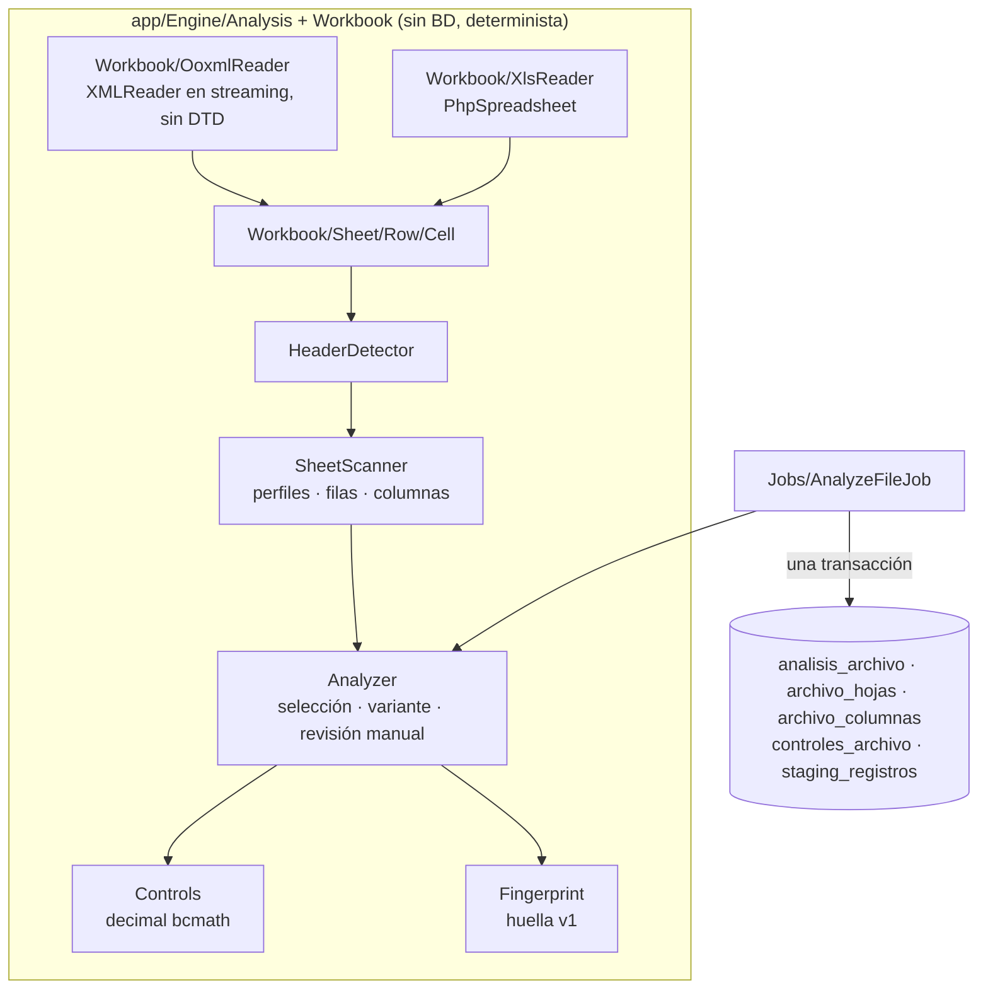

### 6.3 Capa de identidades (FASE 4)

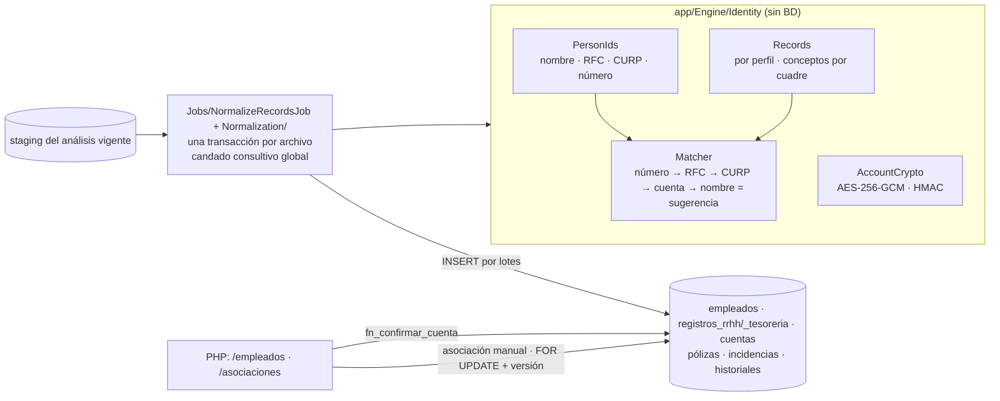

- El parser Excel (`app/Engine/Workbook`, `Analysis`) y la identidad (`app/Engine/Identity`) están separados: la identidad sólo consume el staging.
- PHP nunca ve cuentas en claro salvo al **revelar** (permiso + POST + auditoría); la confirmación de CLABE copia HMAC y cifrado dentro de la BD.

### 6.4 Conciliación financiera (FASE 5)

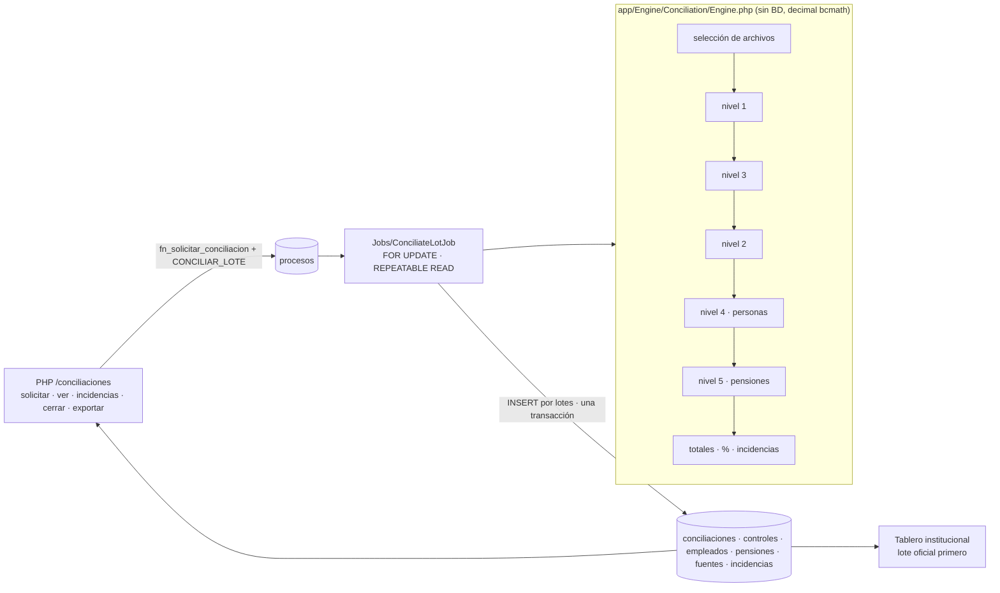

- La huella SHA-256 de las entradas canónicas y la versión del motor hacen reproducible cada ejecución; una ejecución con la misma huella queda marcada `igual_a_id`.
- Las ejecuciones son inmutables: reprocesar crea v2, v3…

### 6.5 Operación y reportes (FASE 6)

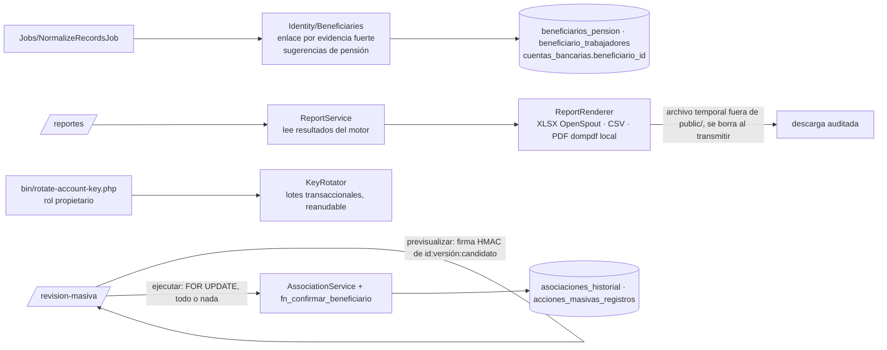

- Una confirmación de identidad **no** reescribe conciliaciones. `ConciliationComparison` detecta los cambios posteriores (vista previa técnica) y compara ejecuciones derivando los motivos de las fuentes y del historial.
- **Sin servicios externos:** el PDF se genera localmente, sin red.

### 6.6 Identidad y operación (FASE 7)

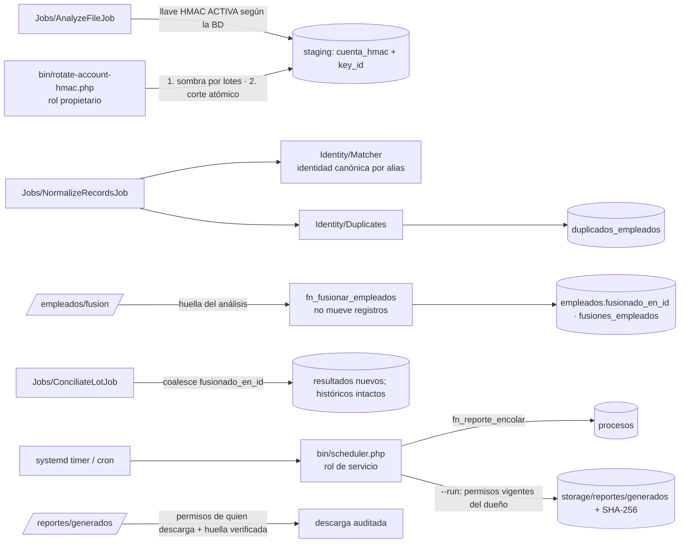

- **HMAC:** llave activa en la BD, sombra reanudable y corte atómico (`docs/HMAC_ROTATION.md`).
- **Fusión:** alias no destructivo, resolución de un salto, separación correctiva por ADMIN o GOD (`docs/IDENTITY_MERGE.md`).
- **Reportes programados:** la misma cola y el ejecutor PHP; los permisos del dueño se evalúan al generar (`docs/SCHEDULED_REPORTS.md`).

## 6b. Servicios transversales (FASE 8)

- **Notificaciones.** Las crea la BD mediante disparadores, igual si el cambio viene de PHP, del worker o del scheduler. La web sólo lee, marca y borra las del actor (RLS). La campana sondea `/api/notificaciones/resumen` cada 60 s con la pestaña visible.
- **Doble aprobación.** `MergeService` → `fn_solicitar_fusion_critica` y `fn_aprobar_solicitud_fusion`, que comparten `fn_fusion_validar` y `fn_fusion_aplicar` con la fusión directa.
- **Cifrado de reportes.** `ReportCipher` (PHP, libsodium). Cifra el scheduler (`ReportJobRunner`) y descifra la web al transmitir (`Response::withStreamWriter`).
- **Salud.** `HealthService` lee `workers`, `procesos`, `sistema_ejecuciones` (escritas por el scheduler, la CLI de almacenamiento y `scripts/backup.sh`), `schema_migraciones` y el disco.
- **Tablero.** `AttentionService` calcula en el momento las tareas que el usuario puede resolver.

## 6c. La quincena como centro del proceso

El flujo operativo sigue el proceso real: **Quincena → Nómina de RH → Pagos de Tesorería → lectura → Cotejar → Resultados**. La pantalla de la quincena reúne lo que antes estaba repartido entre periodos, lotes, importaciones y conciliaciones.

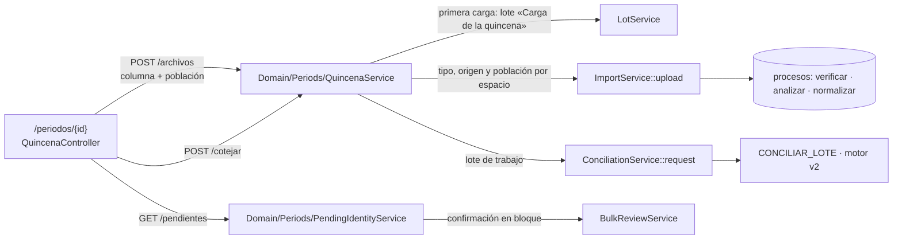

- **`QuincenaService`** (`app/Domain/Periods/`): define la matriz Policías/Bomberos × «Nómina de RH» / «Pagos de nómina» / «Pensiones alimenticias» y las pólizas opcionales; cada espacio fija tipo documental, origen y población (`archivos_importados.poblacion`, migración 0025). Usa un **lote de trabajo** por quincena (`workingLot`: el oficial, si no el abierto más reciente) y lo crea en la primera carga. Admite hasta 10 archivos por carga; un error en uno no detiene los demás. `cotejar` exige la nómina y los pagos de ambas poblaciones leídos y ningún archivo sin población; las pensiones no son obligatorias. Los lotes siguen existiendo (GOD los ve en «Lotes de carga»), pero la persona operativa no los maneja.
- **`PendingIdentityService`** (`app/Domain/Periods/`): lista los pagos de la quincena sin persona identificada y propone la **confirmación en bloque** sólo de los pagos de nómina cuya propuesta es `NOMBRE_EXACTO` con un único candidato, cuyo importe es igual al neto de RH de esa persona (con un solo registro de RH en el lote), que no tiene otro pago de nómina identificado y que ningún otro pendiente propone. Reutiliza la revisión masiva (`BulkReviewService`: vista previa firmada, todo o nada, auditoría y CLABE recordada con `cuentas.confirmar`). El resto se revisa uno por uno en la pantalla de asociación existente. Rutas: `GET /periodos/{id}/pendientes` (`asociaciones.ver`) y `POST /periodos/{id}/pendientes/confirmar` (`asociaciones.masivo`).
- **Motor v2** (`docs/CONCILIATION_ENGINE.md` §6b): usa la población declarada para los archivos sin número de empleado y coteja las pensiones sin beneficiario identificado contra el total de su población. Nunca compara nombres por parecido.
- **Resultados:** `/conciliaciones/{id}`, `/empleados` (filtros de población y resultado) y `/pensiones` (nueva, por población y por persona). Las migas siguen la quincena: `Quincenas › {periodo} › Cotejo n.º N`.
- **Menú:** «Avanzado» (archivos, cotejos, revisiones, asociaciones, duplicados, fusiones, reportes programados) sólo aparece a GOD. Los permisos de las rutas no cambiaron.

## 7. Notas de entorno

- **Mínimo privilegio en desarrollo.** `web` y `worker` reciben sólo sus credenciales y el `.env` del host queda oculto dentro de los contenedores. Las credenciales del propietario (NOSUPERUSER) sólo existen en el servicio bajo demanda `tools` (migraciones, alta del GOD y pruebas). El servicio `worker` usa la misma imagen `conciliarh-web` y ejecuta `php bin/worker.php worker`.
- **Docker Desktop en Linux.** Su uso compartido de archivos no propagó de forma fiable los archivos guardados por renombrado atómico: el contenedor seguía viendo versiones anteriores. Se recomienda el motor nativo (`make … DOCKER_CONTEXT=default`). Producción no usa Docker.
- **Códigos HTTP no estándar.** Apache 2.4 convierte en "500" la línea de estado de un código no registrado, como 419. Por eso un CSRF inválido responde **403** con el código `CSRF_INVALIDO` en el cuerpo.
- **Almacenamiento compartido.** El worker necesita leer `storage/imports` (originales 0440). En desarrollo se monta en **sólo lectura**. En producción, PHP y el worker deben compartir un grupo (p. ej. `conciliarh`) con `umask` 027; el worker no necesita escribir en `imports/`.
- **Rutas `stateless`.** `/api/health` no abre sesión ni escribe en la BD, así que los sondeos de monitoreo no generan filas de sesión.
