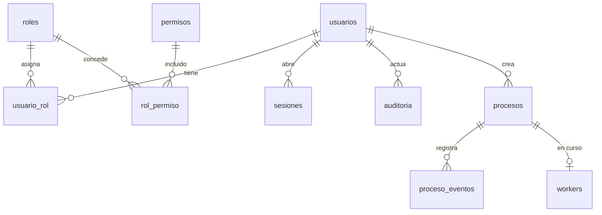
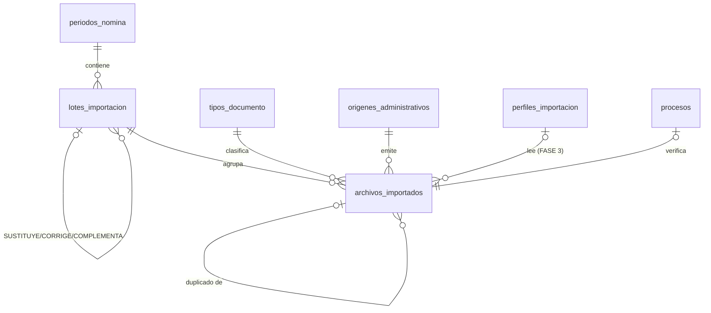
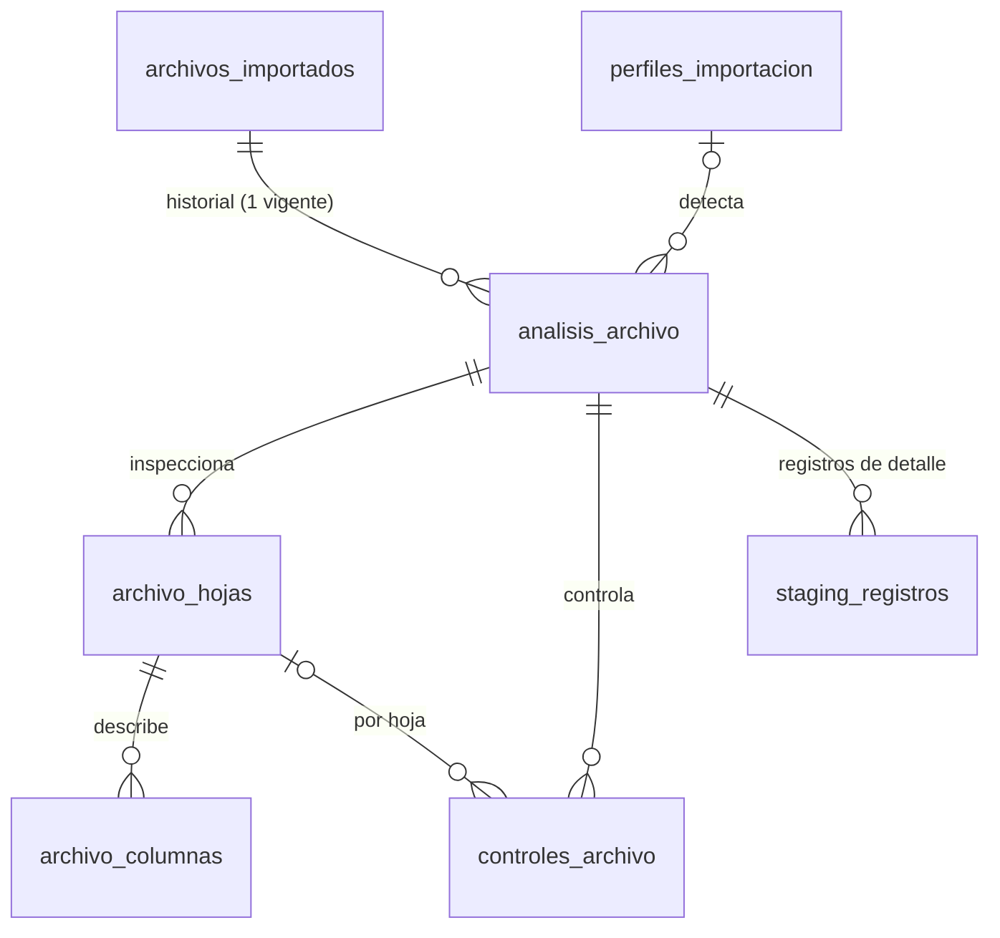
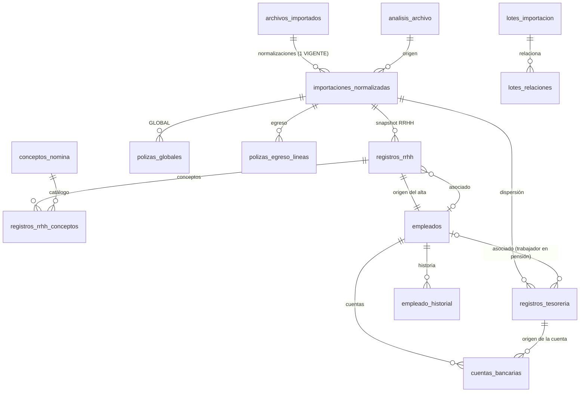
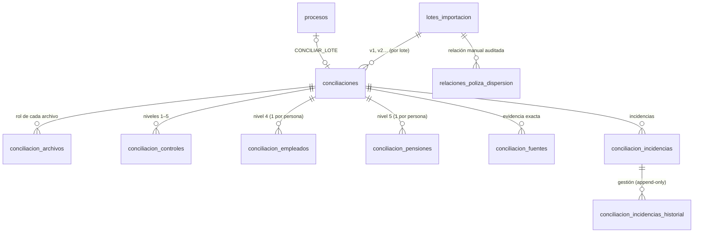

# Base de datos — ConciliaRH

- **Motor:** PostgreSQL ≥ 14. Desarrollo con PostgreSQL 17.
- **Zona horaria:** `America/Mexico_City`, fijada en cada conexión.
- **Estado:** migraciones 0001–0029. El detalle de 0011 en adelante está en §4d–§4n.

## 1. Convenciones

| Tema | Regla |
|---|---|
| Claves | `bigint GENERATED ALWAYS AS IDENTITY` |
| Fechas de evento | `timestamptz` |
| Dinero | `NUMERIC(14,2)`. **Nunca** `float`/`real`/`double` |
| Estados | `text` + `CHECK` (se extienden con migraciones nuevas; se evita `ENUM`) |
| Borrado | Lógico (`activo`, `deleted_at`, `deleted_by`) en datos de negocio y usuarios. La auditoría **nunca** se borra |
| Idioma | Dominio en español (tablas y columnas); funciones técnicas con prefijo `fn_` |
| Búsqueda sin acentos | `unaccent_simple(text)`: función SQL inmutable que no requiere la extensión `unaccent` |

## 2. Roles de base de datos (mínimo privilegio)

| Rol | Uso | Privilegios clave |
|---|---|---|
| `conciliarh_owner` | Dueño del esquema: migraciones (`bin/migrate.php`) y alta del GOD (`bin/create-god.php`) | DDL. **NOSUPERUSER** (también en desarrollo). Sus credenciales sólo se proporcionan al ejecutar esos comandos |
| `conciliarh_web` | Aplicación PHP | CRUD acotado con **privilegios por columna** (0005). Sin `DELETE` en usuarios ni auditoría. No puede asignar ni retirar el rol GOD (trigger) |
| `conciliarh_worker` | Procesador en segundo plano (worker PHP, `bin/worker.php`) | `SELECT`/`UPDATE` (sólo columnas de ejecución) en `procesos`; `INSERT` en eventos y auditoría. **Sin acceso** a `usuarios`, `sesiones` ni lectura de `auditoria` |
| `conciliarh_backup` | `scripts/backup.sh` (FASE 9, `deploy/postgres/01-roles-y-base.sql`) | Sólo lectura de todo el esquema; `BYPASSRLS` para que `pg_dump` lea `notificaciones`; sin escritura salvo el registro de su resultado (`02-despues-de-migrar.sql`) |

Los roles los crea el DBA. En desarrollo los crea `infra/docker/postgres/init/01-roles.sh`. Todas las migraciones otorgan permisos explícitos (`GRANT`); no se usan privilegios por omisión.

## 3. Migraciones

**Formato:** `database/migrations/NNNN_nombre.up.sql` y `NNNN_nombre.down.sql`. Las aplica `bin/migrate.php`:
- **Transacción por migración.** PostgreSQL permite DDL transaccional.
- **`pg_advisory_lock`.** Impide ejecutar dos migradores a la vez.
- **SHA-256 de cada archivo en `schema_migraciones`.** Si una migración ya aplicada cambia, el migrador **se detiene**. Toda corrección requiere una migración nueva.
- **`down` bloqueado cuando `APP_ENV=production`.**

| # | Archivo | Contenido | Reversión |
|---|---|---|---|
| 0001 | `0001_seguridad` | `usuarios`, `roles`, `permisos`, `rol_permiso`, `usuario_rol`, `sesiones`, `intentos_login`, `configuracion`; `fn_set_updated_at`, `unaccent_simple`; trigger `solo_god` | `0001_seguridad.down.sql` (sólo desarrollo) |
| 0002 | `0002_auditoria` | `auditoria` append-only con cadena SHA-256; `fn_auditoria_encadenar`, `fn_auditoria_inmutable`, `fn_auditoria_verificar` | Sólo desarrollo |
| 0003 | `0003_procesos` | Cola de trabajos (`procesos`), `proceso_eventos`, `workers` | Sólo desarrollo |
| 0004 | `0004_catalogo_seguridad` | Roles de sistema, 19 permisos, matriz rol-permiso y 6 parámetros funcionales | Sólo desarrollo |
| 0005 | `0005_endurecimiento` | Tras la revisión de seguridad: privilegios por columna (web y worker), trigger `usuario_rol_god_protegido`, auditoría `hash_version` (v2: `user_agent` y `clock_timestamp()`), `intentos_login.ambito`, 2 parámetros nuevos | Sólo desarrollo |
| 0006 | `0006_periodos_lotes` | Catálogos `tipos_documento`, `origenes_administrativos`, `perfiles_importacion` (9 perfiles, `implementado=false`); `periodos_nomina`, `lotes_importacion`; `fn_lote_periodo_abierto`, `fn_crear_lote` (numeración segura ante concurrencia) | Sólo desarrollo |
| 0007 | `0007_archivos_importados` | `archivos_importados`; triggers `fn_archivo_reglas` (máquina de estados e inmutabilidad) y `fn_proceso_a_archivo` (sincroniza fallos de la cola); vista `v_lotes_resumen` | Sólo desarrollo |
| 0008 | `0008_permisos_importacion` | 21 permisos (`periodos.*`, `lotes.*`, `archivos.*`, `catalogos.*`; 5 `solo_god`), matriz por rol, 4 límites de contenedor en `configuracion`, `usuarios.es_desarrollo` | Sólo desarrollo |
| 0009 | `0009_endurecimiento_importacion` | Tras las revisiones de FASE 2: `fn_archivo_reglas` v2 (RECIBIDO→ERROR; estados de resultado reservados al motor), `fn_proceso_a_archivo` v2 (cancelado → ERROR `VERIFICACION_CANCELADA`), `REVOKE INSERT` de `lotes_importacion` al rol web, ANALISTA sin `lotes.cerrar`, `v_lotes_resumen` con `VERIFICADO` | Sólo desarrollo |
| 0010 | `0010_analisis_archivos` | FASE 3: `analisis_archivo`, `archivo_hojas`, `archivo_columnas`, `controles_archivo`, `staging_registros`; perfiles reales (familia/variante), estado `REVISION_MANUAL` y clasificaciones `SIN_HUELLA`/`REVISION_MANUAL`, selección manual con invalidación de huella por trigger, trigger `fn_archivo_encolar_analisis`, `fn_proceso_a_archivo` v3, `v_lotes_resumen` v3, 5 permisos `analisis.*`, 4 parámetros | Sólo desarrollo |

## 4. Esquema implementado (FASE 1)



### 4.1 `usuarios`

- **Identificación:** `username` único, en minúsculas y validado por `CHECK`. Nunca se reutiliza, ni siquiera tras un borrado lógico. **No existe columna de correo.**
- **Credenciales:** `password_hash` (Argon2id), `debe_cambiar_password`, `password_cambiado_at`.
- **Estado:** `activo`, `deleted_at`/`deleted_by` coherentes por `CHECK` (un usuario borrado siempre queda inactivo).

### 4.2 RBAC

- `roles.protegido`: GOD y ADMIN, que sólo GOD puede asignar.
- `roles.es_sistema`: roles creados por migración.
- `permisos.solo_god`: el trigger `fn_rol_permiso_solo_god` impide asignarlos a cualquier rol distinto de GOD, aunque la aplicación fallara.
- `permisos.sensible`: acción que se audita siempre.

### 4.3 `sesiones`

- **Identificador:** `id` = SHA-256 del ID de sesión. El ID real no se guarda.
- **Contenido:** `usuario_id`, `ip`, `user_agent`, marcas de actividad.
- **Revocación:** `revocada_at`, `revocada_por`, `motivo_revocacion`. Una sesión revocada o inactiva no se lee ni se revive.

### 4.4 `intentos_login`

- **Clave:** `username_hmac` = HMAC-SHA256 con `ACCOUNT_HMAC_KEY` y un `ambito` (`login` o `cambio_password`). El texto tecleado nunca se guarda, porque podría ser una contraseña escrita por error en el campo de usuario.
- **Uso:** los índices por usuario e IP sostienen el bloqueo por ventana de tiempo.

### 4.5 `configuracion`

- **Tipos:** `decimal`, `entero`, `booleano`, `texto`, con `minimo` y `maximo`.
- **Permisos:** `solo_god` exige que sólo GOD pueda editar el parámetro.
- **Parámetros actuales:**

| Parámetro | Valor |
|---|---|
| `conciliacion.tolerancia_monetaria` | `0.01` |
| `seguridad.login_max_intentos_usuario` | `5` |
| `seguridad.login_max_intentos_ip` | `30` |
| `seguridad.login_ventana_minutos` | `15` |
| `seguridad.password_longitud_minima` | `12` |
| `procesos.max_intentos_predeterminado` | `3` |
| `seguridad.login_max_intentos_usuario_global` | `20` (0005) |
| `seguridad.cambio_password_max_intentos` | `5` (0005) |

`seguridad.login_max_intentos_usuario` cuenta por **pareja usuario + IP**; el global frena ataques distribuidos.

### 4.6 `auditoria` (append-only)

- **Campos:** `secuencia` (orden de la cadena), `usuario_id`, instantáneas de `username` y `roles`, `origen` (WEB/CLI/WORKER/SISTEMA), `ip`, `user_agent`, `accion`, `entidad`, `entidad_id`, `valor_anterior`, `valor_nuevo`, `contexto` (JSONB, ya redactado), `hash_prev` y `hash`.
- **`fn_auditoria_encadenar`** (`BEFORE INSERT`, `SECURITY DEFINER`, `search_path` fijo):
  1. Toma un advisory lock de transacción.
  2. Asigna `secuencia` = última + 1.
  3. Calcula `hash = SHA-256(hash_prev | contenido canónico)`. El timestamp va en microsegundos UTC, lo que hace el cálculo independiente de la zona horaria.
- **`fn_auditoria_inmutable`:**
  - Bloquea `UPDATE`, `DELETE` y `TRUNCATE` **incluso al propietario**.
  - Única excepción: mantenimiento técnico explícito (`SET LOCAL conciliarh.auditoria_mantenimiento = 'on'` ejecutado por el propietario de la tabla). Además, los roles de aplicación carecen de esos privilegios.
- **Versión 2 del hash (0005):** incluye `user_agent` y usa `clock_timestamp()`. Cada registro guarda su `hash_version` y los registros v1 se verifican con su fórmula original.
- **`fn_auditoria_verificar()`:** recorre la cadena y devuelve `(integra, registros, primer_secuencia_invalida)`. El primer registro existente es el ancla.
- **Verificación:** probado que una alteración hecha en modo mantenimiento **sí** se detecta.

### 4.7 Cola `procesos` / `proceso_eventos` / `workers`

El protocolo completo está en [`ARCHITECTURE.md`](ARCHITECTURE.md#6-cola-de-trabajos-web--postgresql--procesador).

| Grupo | Columnas |
|---|---|
| Identificación y contrato | `tipo`, `contract_version`, `parametros` (objeto JSON), `clave_idempotencia` (única parcial) |
| Estado | `estado`, `etapa`, `progreso`, `mensaje` |
| Planificación y límites | `prioridad`, `intentos`, `max_intentos` (1–10), `timeout_segundos`, `disponible_desde` |
| Bloqueo y latido | `bloqueado_por`, `token_bloqueo` (UUID del lease), `bloqueado_at`, `heartbeat_at` |
| Resultado y error | `resultado`, `error_codigo`, `error_mensaje` (para el usuario), `error_detalle` (técnico, con permiso) |

**Restricciones clave:**
- `estado = 'EN_EJECUCION'` ⇔ `token_bloqueo` y `bloqueado_por` no nulos.
- `intentos <= max_intentos`. Esto hace imposibles los reintentos infinitos incluso ante un error de código.
- Índice parcial `procesos_pendientes_idx (prioridad, id) WHERE estado = 'PENDIENTE'` para el reclamo.

## 4b. Esquema implementado (FASE 2)



### 4b.1 Catálogos
| Tabla | Semilla | Reglas |
|---|---|---|
| `tipos_documento` | `RRHH_TABULADO`, `RRHH_POLIZA_GLOBAL`, `POLIZA_EGRESO_BANCARIA`, `TESORERIA_DISPERSION`, `TESORERIA_PENSION`, `OTRO` | Código `^[A-Z][A-Z0-9_]{1,59}$` único; sólo GOD crea o desactiva |
| `origenes_administrativos` | `SIN_DEFINIR` (omisión), `RRHH`, `TESORERIA`, `CONTABILIDAD`, `OTRO` | `SIN_DEFINIR` y `OTRO` no se desactivan |
| `perfiles_importacion` | 9 perfiles reales observados, todos `implementado=false` | Se activan en FASE 3–5; cómo se lee ≠ qué es ≠ quién lo emite |

### 4b.2 `periodos_nomina`
- `anio` (2000–2100), `mes` smallint 1–12, `quincena` 1–2, `tipo` `ORDINARIA|EXTRAORDINARIA`, `fecha_inicio`/`fecha_fin` dentro del mes y la quincena (CHECK), `descripcion`.
- `estado` `ABIERTO|CERRADO|ANULADO` con CHECK de coherencia de `cerrado_*` y `anulado_*`; `motivo_estado`.
- `ultimo_numero_lote` (contador; lo actualiza sólo `fn_crear_lote`).
- **UNIQUE** `periodos_nomina_uk (anio, mes, quincena, tipo)`; índice `(estado, anio DESC, mes DESC)`.
- El rol web no puede modificar `anio`, `mes`, `quincena`, `tipo` ni `ultimo_numero_lote` (privilegios por columna).

### 4b.3 `lotes_importacion`
- `numero` (> 0), `nombre` (omisión "Carga 00N"), `descripcion`, `origen`, `observaciones`, `estado` `ABIERTO|CERRADO|ANULADO`.
- `es_oficial` + `declarado_oficial_por/at` (CHECK de coherencia; un lote anulado no puede ser oficial).
- `lote_relacionado_id` + `tipo_relacion` `SUSTITUYE|CORRIGE|COMPLEMENTA` (ambos o ninguno; no a sí mismo).
- **UNIQUE** `(periodo_id, numero)`; **UNIQUE parcial** `(periodo_id) WHERE es_oficial` → máximo un lote oficial por periodo.
- Trigger `fn_lote_periodo_abierto`: no se crean ni reabren lotes en un periodo no abierto.
- **Numeración:** el rol web **no** tiene `INSERT` sobre la tabla (0009); sólo `fn_crear_lote(...)` (`SECURITY DEFINER`, `search_path` fijo) hace `UPDATE periodos_nomina SET ultimo_numero_lote = ultimo_numero_lote + 1 ... RETURNING` (bloqueo de fila) y luego el `INSERT`. Dos cargas simultáneas se serializan: nunca hay número repetido (probado con 10 hilos). No usa `max()+1`. Un número consumido por una transacción revertida no se reutiliza (huecos aceptables, sin duplicados).

### 4b.4 `archivos_importados`
| Grupo | Columnas |
|---|---|
| Identidad | `id`, `uuid` (UNIQUE), `lote_id`, `ruta_relativa` (UNIQUE; CHECK `^imports/[0-9]+/[0-9]+/[0-9a-f-]{36}/original\.(xls\|xlsx\|xlsm)$`) |
| Clasificación | `tipo_documento_id`, `origen_administrativo_id`, `perfil_importacion_id` (NULL hasta FASE 3) |
| Binario | `nombre_original` (1–255, sin `/`, `\` ni controles), `extension` `xls\|xlsx\|xlsm`, `firma` `OLE2\|OOXML` (coherente con la extensión), `mime_declarado`, `mime_detectado`, `tamano_bytes > 0`, `sha256` (hex 64), `tiene_macros`, `contenedor` jsonb |
| Contenido | `huella_contenido` + `huella_version` (ambos o ninguno; sólo cambia la huella si cambia la versión) |
| Población | `poblacion` `POLICIA\|BOMBEROS` o NULL (desde 0025; ver §4j) |
| Duplicidad | `clasificacion_duplicidad` `PENDIENTE\|NUEVO\|DUPLICADO_BINARIO\|DUPLICADO_CONTENIDO\|POSIBLE_VERSION`, `archivo_relacionado_id` |
| Ciclo de vida | `estado` (ver `docs/IMPORTS.md` §3.3), `proceso_id`, `error_codigo`, `error_resumen`, `verificado_at`, `procesado_at`, `anulado_por/at`, `motivo_anulacion`, `usuario_carga_id`, `created_at`, `updated_at` |

**Índices:** UNIQUE `uuid`; UNIQUE `ruta_relativa`; **UNIQUE parcial `(lote_id, sha256) WHERE estado <> 'ANULADO'`** (el mismo binario no entra dos veces en un lote); `sha256`; `huella_contenido` (parcial); `(lote_id, created_at)`; `(estado, created_at)`; `tipo_documento_id`; `origen_administrativo_id`; `(usuario_carga_id, created_at)`; `created_at`.

**Triggers:**
- `fn_archivo_reglas` (BEFORE INSERT/UPDATE): INSERT sólo en `RECIBIDO` con lote y periodo abiertos; SHA-256, tamaño, ruta, extensión, firma, nombre, lote, UUID y autor **inmutables incluso para el propietario**; transiciones de estado en lista blanca.
- `fn_proceso_a_archivo` (AFTER UPDATE OF estado ON procesos, `SECURITY DEFINER`): un `VERIFICAR_ARCHIVO` que termina en `ERROR` deja el archivo en `ERROR`; uno `CANCELADO` lo regresa de `VERIFICANDO` a `RECIBIDO`.

**Vista `v_lotes_resumen`:** conteos por estado y `estado_procesamiento` derivado (`SIN_ARCHIVOS`, `PROCESANDO`, `CON_ERRORES`, `CON_ADVERTENCIAS`, `VERIFICADO` desde 0009, `LISTO`). El estado de procesamiento **no se almacena** para evitar dos fuentes de verdad.

**Privilegios:** web: `SELECT`, `INSERT` y `UPDATE` sólo de columnas de clasificación/estado/anulación; nunca `DELETE`. Desde 0009 el trigger limita además **qué estados** puede fijar el rol web (sólo `RECIBIDO` y `ANULADO`; error `42501` en otro caso). Worker: `SELECT` y `UPDATE` de columnas de verificación (`estado`, `tiene_macros`, `contenedor`, `error_*`, `verificado_at`, `mime_detectado`); sin acceso a `usuarios`.

### 4b.5 `usuarios.es_desarrollo`
Marca las cuentas creadas por `bin/dev-seed.php`. El rol web no puede escribirla. `AuthService` rechaza estas cuentas en producción, tanto al iniciar sesión como al cargar una sesión existente.

## 4c. Esquema implementado (FASE 3 · análisis)



| Tabla | Clave / índices | Restricciones principales |
|---|---|---|
| `analisis_archivo` | UNIQUE `(archivo_id, numero)`; UNIQUE parcial `(archivo_id) WHERE vigente`; índice por huella | `resultado` ∈ ANALIZADO · ANALIZADO_CON_ADVERTENCIAS · REVISION_MANUAL; `perfil_confianza` ∈ ALTA · MEDIA · BAJA · MANUAL · NINGUNA; orígenes AUTOMATICO/MANUAL; huella y versión juntas; `advertencias` es arreglo JSON |
| `archivo_hojas` | UNIQUE `(analisis_id, indice)`; UNIQUE parcial `(analisis_id) WHERE seleccionada` | `visibilidad` VISIBLE/OCULTA/MUY_OCULTA; `estado` SELECCIONADA/INCLUIDA/CANDIDATA/DESCARTADA/VACIA/AUXILIAR; `seleccionada ⇔ estado = SELECCIONADA`; `tiene_formulas` NULL en .xls (no expuesto) |
| `archivo_columnas` | UNIQUE `(hoja_id, indice)` | `tipo_inferido` TEXTO/NUMERO/MONEDA/FECHA/BOOLEANO/MIXTO/VACIA; `identificador_probable` RFC/CURP/CLABE/CUENTA/NUM_EMPLEADO; sin valores de celdas |
| `controles_archivo` | UNIQUE `(analisis_id, coalesce(hoja_id, 0), codigo)` | `estado` CUADRA/NO_CUADRA/SIN_TOTAL/MULTIPLES_TOTALES/TOTAL_INVALIDO/NO_APLICA; `tipo_valor` MONEDA/ENTERO; importes `NUMERIC(18,2)` |
| `staging_registros` | índices `(analisis_id, fila_origen)`, `hash_registro`, `clave_hash` (parcial) | `importe NUMERIC(14,2)`; `importe_estado`; hashes hex de 64; cuenta sólo como HMAC + últimos 4 |

- **Sustitución controlada:** al persistir un análisis nuevo, el anterior queda `vigente = false` y se **borran** sus hojas (en cascada: columnas, controles por hoja y staging), sus controles de archivo y su staging. `analisis_archivo` conserva el historial.
- **`archivos_importados` (0010):** `hoja_manual_indice/nombre`, `perfil_manual_id`, `seleccion_manual_por/at`, `analisis_vigente_id`; estado `REVISION_MANUAL`; clasificaciones `SIN_HUELLA` y `REVISION_MANUAL` (sin archivo relacionado).
- **`fn_archivo_reglas` v3:** transiciones de análisis (VERIFICADO→ANALIZANDO→ANALIZADO | ANALIZADO_CON_ADVERTENCIAS | REVISION_MANUAL | ERROR; reanálisis desde ANALIZADO*/REVISION_MANUAL). La selección manual sólo se acepta en estados analizables e **invalida** huella y clasificación por contenido. El rol web sigue limitado a RECIBIDO/ANULADO.
- **`fn_archivo_encolar_analisis`** (`SECURITY DEFINER`, trigger `archivos_zz_encolar_analisis` para ejecutarse después de `archivos_reglas`): VERIFICANDO→VERIFICADO encola `ANALIZAR_ARCHIVO` (idempotente) y emite `NOTIFY`.
- **`fn_proceso_a_archivo` v3:** un `ANALIZAR_ARCHIVO` en ERROR o CANCELADO deja el archivo en `ERROR` (`ERROR_ANALISIS` / `ANALISIS_CANCELADO`) si estaba VERIFICADO o ANALIZANDO.
- **`v_lotes_resumen` v3:** VERIFICADO cuenta como "en proceso" (falta el análisis); nuevo estado de lote `REVISION_MANUAL`; columnas `en_revision` y `duplicados_contenido`.
- **Perfiles:** columnas `familia` y `reglas_version`; 11 perfiles implementados (los genéricos de RRHH quedan inactivos).
- **Privilegios:** web: `SELECT` de las tablas de análisis, `SELECT` de `staging_registros` **sólo por columnas** (sin `datos` ni `cuenta_hmac`) y `UPDATE` sólo de las columnas de selección manual; worker: `SELECT/INSERT` en `analisis_archivo` (+ `UPDATE(vigente)`), `SELECT/INSERT/DELETE` en las tablas derivadas y `UPDATE(analisis_vigente_id)`.
- **Parámetros:** `analisis.max_celdas` (1 000 000; máx. 2 000 000), `analisis.timeout_segundos` (900), `analisis.margen_ambiguedad` (10), `analisis.reanalisis_espera_segundos` (30).
- **Huella:** sólo se fija al cerrar un análisis (ANALIZANDO → resultado); `analisis_archivo.numero` es `integer`.

## 4d. Esquema implementado (FASE 4 · identidades y registros; migración 0011)

Detalle de reglas en `docs/IDENTITY_MATCHING.md`.



| Tabla | Clave / índices | Restricciones principales |
|---|---|---|
| `conceptos_nomina` | UNIQUE `codigo` | código `^[0-9]{3}$`; tipo PERCEPCION/DEDUCCION/DESCONOCIDO; `es_pension ⇒ DEDUCCION`; clasificación CONFIGURADA/INFERIDA; semilla 044, 060, 171, 249, 263 |
| `importaciones_normalizadas` | UNIQUE `(archivo_id, numero)`; UNIQUE parcial `(archivo_id) WHERE VIGENTE`; `(periodo_id, tipo_registro)` vigentes | estado VIGENTE/SUSTITUIDA/INVALIDADA; tipo RRHH/TESORERIA/POLIZA_GLOBAL/POLIZA_EGRESO; sólo RRHH puede actualizar el maestro |
| `empleados` | UNIQUE `numero_empleado`; índices `rfc`, `curp` (**sin UNIQUE**), `nombre_normalizado text_pattern_ops`, `(grupo, activo)` | número `^[0-9A-Z][0-9A-Z-]{0,19}$` con dígito; `rfc_valido`/`curp_valida` **GENERATED**; `fuente_creacion` sólo `RRHH_TABULADO`; origen FK (diferida) a `registros_rrhh`; número y origen inmutables (trigger); sin DELETE |
| `empleado_historial` | `(empleado_id, id DESC)` | sólo inserción (trigger); fuente ALTA_RRHH/RRHH_TABULADO/MANUAL; MANUAL exige usuario y motivo |
| `registros_rrhh` | UNIQUE `(importacion_id, hoja_indice, fila_origen)`; `(empleado_id, periodo_id)`; `(periodo_id, grupo)`; `(archivo_id, fila_origen)`; pendientes (parcial); `(archivo_id, hash_registro)` | importes `NUMERIC(14,2)`; estado/método/confianza por CHECK; asociado ⇔ empleado; decisión manual ⇔ usuario y fecha; `hoja_id` con `ON DELETE SET NULL` (el reanálisis sustituye hojas; índice y nombre se conservan) |
| `registros_rrhh_conceptos` | UNIQUE `(registro_id, codigo)` | importe OK ⇔ no nulo |
| `registros_tesoreria` | igual que RRHH + `cuenta_hmac` (parcial) | categoría NOMINA/PENSION; banco SANTANDER/BBVA/INTERBANCARIA; método nunca `ALTA_RRHH`; **pensión nunca por NOMBRE_EXACTO**; cuenta: HMAC hex, últimos 4, cifrado ⇔ key_id |
| `cuentas_bancarias` | UNIQUE parcial `(cuenta_hmac, uso) WHERE ACTIVA`; `(empleado_id, estado)` | uso NOMINA/PENSION_BENEFICIARIO; tipo CUENTA/CLABE; cifrado con versión `0x01` y longitud acotada; CONFIRMACION_MANUAL ⇔ confirmado_por/at; INACTIVA ⇔ desactivado_at; identidad inmutable; no se reactiva ni se borra |
| `polizas_globales` / `_lineas` | UNIQUE `(importacion_id, hoja_indice)` / `(poliza_id, fila_origen, bloque)` | grupo POLICIA/BOMBEROS; bloque PERCEPCIONES/DEDUCCIONES |
| `polizas_egreso_lineas` | UNIQUE `(importacion_id, hoja_indice, fila_origen)`; `(periodo_id, banco)` | banco derivado de la hoja; DEBE/HABER `NUMERIC(16,2)` |
| `incidencias_identidad` | UNIQUE `clave`; abiertas por tipo/severidad; por registro, empleado e importación | severidad INFO/ADVERTENCIA/ALTA; estado ABIERTA/RESUELTA/DESCARTADA ⇔ `resuelto_at` |
| `asociaciones_historial` | `(registro_tipo, registro_id, id DESC)` | sólo inserción; acciones manuales exigen usuario y motivo |
| `lotes_relaciones` | UNIQUE parcial `(origen, destino, tipo) WHERE ACTIVA` | CORRIGE/SUSTITUYE/COMPLEMENTA/RELACIONADO; mismo periodo y lotes vigentes (trigger); sin relación inversa de corrección/sustitución; sólo se anula |

- **Staging (0011):** `cuenta_cifrada` + `cuenta_key_id` (AES-256-GCM). La web sigue sin leerlos.
- **Funciones:** `fn_solo_insercion` (tablas de historial; excepción sólo con `SET conciliarh.identidad_mantenimiento = 'on'` **y** siendo el propietario de la tabla, para limpieza de pruebas), `fn_empleado_inmutable`, `fn_cuenta_inmutable`, `fn_lote_relacion_reglas`; `SECURITY DEFINER`: `fn_archivo_encolar_normalizacion` (ANALIZANDO → ANALIZADO* encola `NORMALIZAR_REGISTROS`), `fn_archivo_invalidar_importacion` (nuevo análisis o archivo anulado ⇒ importación INVALIDADA), `fn_confirmar_cuenta` (copia HMAC/cifrado desde el registro; exige registro asociado y cuenta no activa para otra persona), `fn_importaciones_con_cuenta` (importaciones vigentes con pendientes que comparten la cuenta, sin exponer el HMAC).
- **Vista:** `v_asociaciones_pendientes` (sólo importaciones vigentes; sin cuentas).
- **Privilegios:** web: lectura de todo salvo `cuenta_hmac`/`cuenta_cifrada` de registros de Tesorería y `cuenta_hmac` de cuentas; `UPDATE` sólo de columnas de asociación, de corrección del maestro, de estado de cuentas/incidencias/relaciones y del catálogo; `INSERT` en historiales y relaciones; `EXECUTE` de las dos funciones de cuentas. Worker: `SELECT/INSERT` en todo, `UPDATE` por columnas, **sin DELETE**, `USAGE` de las secuencias de empleados y registros.
- **Permisos:** `empleados.ver`, `empleados.ver_sensible`, `empleados.editar`, `asociaciones.ver`, `asociaciones.resolver`, `cuentas.ver_sensible`, `cuentas.confirmar`, `lotes.relacionar`, `importacion.normalizar`, `conceptos.editar` (matriz en `IDENTITY_MATCHING.md` §10).
- **Parámetros:** `normalizacion.timeout_segundos` (900), `identidad.similitud_minima` (0.85, informativo).
- **Actualización desde 0.1.0-alpha.3:** la migración encola el **reanálisis** de los archivos ya analizados (su staging no tenía la cuenta cifrada); al cerrar, el trigger encola la normalización.
- La columna `lotes_importacion.lote_relacionado_id/tipo_relacion` (0006) queda sin uso: las relaciones viven en `lotes_relaciones`.

## 4e. Actor de sesión (0012) y conciliación financiera (0013) — FASE 5

Reglas del motor en `docs/CONCILIATION_ENGINE.md`; seguridad en `docs/SECURITY.md` §2e–§2f.

**0012 · actor no suplantable.**
- Funciones:
  - `fn_token_hash`;
  - `fn_actor_actual()`: STABLE SECURITY DEFINER; actor = sesión vigente cuyo `id = sha256(conciliarh.actor_token)`;
  - `fn_es_conexion_web()`;
  - `fn_sesion_vincular(token, usuario, ip, user_agent)`: la única vía para ligar una sesión a un usuario; queda auditada.
- Triggers:
  - `fn_actor_verificar(cols…)`, en todas las columnas de autoría de la web;
  - `auditoria_actor`, que fija el usuario, el nombre y los roles desde la BD;
  - `fn_sesion_reglas`.
- La web pierde `INSERT/UPDATE(usuario_id)` sobre `sesiones`.

**0013 · conciliación.**



| Tabla | Claves e índices | Restricciones |
|---|---|---|
| `conciliaciones` | UNIQUE `(lote_id, numero)`; UNIQUE parcial `(lote_id) WHERE estado IN (PENDIENTE, EJECUTANDO)`; `(periodo_id, lote_id, numero DESC)`; `estado` | `periodo_id`/`lote_id` obligatorios y coherentes (trigger); estado por CHECK (8 valores); transiciones válidas (trigger); cierre ⇔ `cerrada_por`/`_at` (se conserva al invalidar); invalidación ⇔ `invalidada_por`/`_at`; huella hex-64; identidad inmutable; totales, resumen, huella y versión congelados al terminar; sin DELETE/TRUNCATE |
| `conciliacion_archivos` | UNIQUE `(conciliacion_id, archivo_id)` | rol por CHECK (11 valores); sólo inserción durante EJECUTANDO |
| `conciliacion_controles` | UNIQUE `(conciliacion_id, nivel, codigo, coalesce(grupo,''), coalesce(banco,''), coalesce(referencia,''))`; `(conciliacion_id, nivel, estado)` | nivel 1–5; estado CUADRA/NO_CUADRA/NO_DETERMINABLE/REVISION_MANUAL/INFORMATIVO |
| `conciliacion_empleados` | UNIQUE `(conciliacion_id, empleado_id)` (no hay resultados vigentes duplicados); `(conciliacion_id, estado)`; `(conciliacion_id, grupo)`; `(empleado_id)` | estado (10) y alerta por CHECK; **`pagado_total` = Σ bancos** y **`diferencia = pagado_total − neto_esperado`** (CHECK) |
| `conciliacion_pensiones` | UNIQUE `(conciliacion_id, empleado_id)`; `(conciliacion_id, estado)` | estado (6) por CHECK; `diferencia = dispersado − retenido` |
| `conciliacion_fuentes` | `(conciliacion_id, empleado_id)`; `(conciliacion_id, tipo)` | tipo RRHH/TESORERIA_NOMINA/TESORERIA_PENSION/RRHH_PENSION/PENDIENTE_NOMINA/PENDIENTE_PENSION |
| `conciliacion_incidencias` | UNIQUE `(conciliacion_id, clave)`; `(conciliacion_id, estado, severidad, tipo)`; `(conciliacion_id, tipo)`; `(conciliacion_id, banco)`; `(conciliacion_id, empleado_id)` | severidad INFO/ADVERTENCIA/ERROR/CRITICA; estado ABIERTA/EN_REVISION/RESUELTA/ACEPTADA_JUSTIFICADA; inserción sólo durante EJECUTANDO; contenido e importe inmutables; nada cambia si la conciliación está CERRADA o INVALIDADA; sin DELETE |
| `conciliacion_incidencias_historial` | `(incidencia_id, id DESC)` | sólo inserción; comentario obligatorio |
| `relaciones_poliza_dispersion` | UNIQUE parcial `(archivo_egreso_id, hoja_indice) WHERE ACTIVA` | ACTIVA/ANULADA; se anula, no se borra |

- **Funciones:**
  - `fn_solicitar_conciliacion(lote, usuario, motivo)` (SECURITY DEFINER): candado del lote, número siguiente, tolerancia y marca oficial congeladas;
  - `fn_conciliacion_reglas`;
  - `fn_conciliacion_resultado_escribible`;
  - `fn_conciliacion_incidencia_reglas`;
  - `fn_proceso_a_conciliacion` (un trabajo en ERROR o CANCELADO lleva la conciliación a ERROR).
- **Vista:** `v_conciliaciones_vigentes`, la última ejecución terminada por lote.
- **Privilegios:**

  | Rol | Permitido |
  |---|---|
  | Web | `SELECT` de todo; `UPDATE` sólo de cierre, invalidación y `proceso_id` en `conciliaciones`, y de estado, comentario, evidencia y autor en incidencias; `INSERT` en historial y relaciones; `EXECUTE` de `fn_solicitar_conciliacion` |
  | Worker | `SELECT`/`INSERT` de resultados; `UPDATE` de las columnas de ejecución |

- **Permisos nuevos:** `conciliaciones.ver`, `.ver_sensible`, `.ejecutar`, `.reprocesar`, `.cerrar`, `.invalidar`, `.exportar`, `.relacionar`; `incidencias.ver`, `.resolver`.

  | Rol | Permisos |
  |---|---|
  | GOD y ADMIN | Todos |
  | ANALISTA | Todos salvo cerrar e invalidar (desde 0026 el rol ya no existe) |
  | CONSULTA | Sólo `conciliaciones.ver` e `incidencias.ver` (enmascarado) |

- **Parámetros:** `conciliacion.tolerancia_monetaria` (0.01, ya existente), `conciliacion.timeout_segundos` (900) y `conciliacion.cuenta_bancos` (1112).

## 4f. FASE 6: corrección 0014, beneficiarios y revisión masiva (0015)

**0014 · corrección de un defecto de 0.1.0-alpha.5:**
- **Síntoma.** El worker de larga duración fallaba al terminar conciliaciones tras unas 5 ejecuciones en la misma sesión, con `permission denied for function fn_actor_actual`.
- **Causa.** plpgsql usa un plan **genérico** para la expresión de un `IF`, y ese plan verifica EXECUTE de todas las funciones que menciona, aunque el cortocircuito nunca las evalúe.
- **Corrección.** `fn_conciliacion_reglas` se reemplaza con la consulta que usa `fn_actor_actual()` en una sentencia propia dentro de la rama web.
- **Regla vigente.** Una función con EXECUTE sólo para la web **nunca** se menciona en la misma expresión que su guarda dentro de un trigger que también ejecuta el worker.
- Prueba: `test_long_lived_worker_session_survives_generic_plans`.

**0015 · beneficiarios y revisión masiva** (reglas en `docs/BENEFICIARIES.md`):

| Tabla / cambio | Claves e índices | Restricciones |
|---|---|---|
| `beneficiarios_pension` | `nombre_normalizado text_pattern_ops`; `(estado, ultimo_periodo_id)` | origen EVIDENCIA_FUERTE/CONFIRMACION_MANUAL ⇔ confirmado_por/_at; identidad inmutable (trigger); la web sólo edita observaciones, con la autoría **forzada** al actor; sin DELETE/TRUNCATE; autoría verificada con el actor |
| `beneficiario_trabajadores` | UNIQUE parcial `(beneficiario_id, empleado_id) WHERE ACTIVA`; `(empleado_id, estado)` | origen NUMERO_EMPLEADO_ARCHIVO/CUENTA_CONFIRMADA/CONFIRMACION_MANUAL; manual ⇔ autor + motivo; sólo se desactiva (autor, motivo, hora de BD), nunca se reactiva ni se borra; evidencia `jsonb` |
| `cuentas_bancarias.beneficiario_id` | parcial | sólo con uso PENSION_BENEFICIARIO; una vez ligada no cambia de beneficiario (trigger) |
| `registros_tesoreria.beneficiario_id` | parcial | sólo en categoría PENSION |
| `acciones_masivas` | `(usuario_id, id DESC)` | acción por CHECK; motivo 5–1000; 1–5000 registros; huella SHA-256; sólo inserción; autoría = actor |
| `acciones_masivas_registros` | UNIQUE `(accion_masiva_id, registro_tipo, registro_id)`; `(registro_tipo, registro_id)` | sólo inserción; la web sólo escribe el desglose de una acción **suya** y **de la misma transacción** |
| `asociaciones_historial.accion_masiva_id` | parcial | nueva acción `CONFIRMAR_BENEFICIARIO` |

- **Funciones:**
  - `fn_confirmar_beneficiario(registro, usuario, beneficiario, motivo, accion_masiva)` (SECURITY DEFINER). Exige:
    - que el actor sea el de la sesión;
    - la asociación manual del mismo usuario en la misma transacción;
    - los permisos `beneficiarios.confirmar` + `cuentas.confirmar`;
    - importación vigente y periodo abierto;
    - si cita una acción masiva, que sea del mismo usuario y de la misma transacción.

    Crea o reutiliza el beneficiario y la relación y aprende la CLABE (`fn_confirmar_cuenta`). Una CLABE de otro trabajador o de otro beneficiario responde `unique_violation`.
  - `fn_beneficiario_reglas`: las reglas de la web se aplican sólo a la edición **directa** (`current_user = session_user`); dentro de una función SECURITY DEFINER el `session_user` sigue siendo la web y debe poder actualizar `ultimo_periodo_id`.
  - `fn_cuenta_beneficiario_inmutable` y `fn_accion_masiva_registro_reglas`.
  - `fn_historial_accion_masiva`: trigger que exige que el `accion_masiva_id` citado en el historial sea del mismo usuario y de la misma transacción.
- **Vista:** `v_revision_grupos_cuenta`, con una clave **opaca** de misma CLABE (SHA-256 truncado del HMAC con prefijo) y `cuenta_registrada`. Sólo cubre registros pendientes con importación vigente; la web nunca lee el HMAC.
- **Datos existentes:** las cuentas `PENSION_BENEFICIARIO` previas generan beneficiarios (mismo trabajador + mismo nombre = mismo beneficiario) y relaciones, y ligan sus pagos.
- **Permisos (7):** `beneficiarios.ver`, `.confirmar`, `.editar`; `asociaciones.masivo`; `reportes.ver`, `.exportar`, `.exportar_sensible`.
  - GOD y ADMIN los tienen todos; ANALISTA, todos salvo `reportes.exportar_sensible` (desde 0026 el rol ya no existe); CONSULTA sólo `beneficiarios.ver` y `reportes.ver`.
- **Parámetros:** `revision.max_registros_masivo` (500), `reportes.max_por_minuto` (10) y `reportes.max_filas` (50 000).
- **Privilegios:**

  | Rol | Permitido |
  |---|---|
  | Web | SELECT de las tablas nuevas; UPDATE sólo de observaciones del beneficiario y de la desactivación de relaciones; INSERT de acciones masivas, su desglose y `accion_masiva_id` del historial; EXECUTE de `fn_confirmar_beneficiario` |
  | Worker | SELECT/INSERT de beneficiarios y relaciones; UPDATE de `beneficiario_id` y `ultimo_periodo_id` |

## 4g. FASE 7: rotación HMAC (0016), fusión de identidades (0017) y reportes programados (0018)

**0016 · rotación HMAC** (`docs/HMAC_ROTATION.md`):

| Tabla / cambio | Contenido |
|---|---|
| `hmac_llaves_estado` (una fila) | `key_id_activa`: la llave HMAC activa la decide la BD (instalaciones existentes: `h1`). Sólo cambia en el corte de una rotación en curso (trigger). `kcv_activa`: valor de verificación (primer uso) |
| `hmac_rotaciones` | origen, destino, estado `PREPARANDO` / `COMPLETADA` / `CANCELADA`, usuario del SO, fechas y resumen (sólo conteos). Índice único: una sola en curso. Sin DELETE |
| `staging_registros`, `registros_tesoreria` | `cuenta_hmac_key_id` (obligatorio si hay huella) y `cuenta_hmac_nueva` (sombra) |
| `cuentas_bancarias` | `hmac_key_id` (NOT NULL) y `cuenta_hmac_nueva`. Índice único de la sombra `(cuenta_hmac_nueva, uso) WHERE ACTIVA`, que detecta colisiones; el índice vivo no se toca |
| `analisis_archivo.hash_key_id` | Llave de las huellas de registro del análisis |
| `workers.hmac_key_ids` | Ids del anillo que declara cada worker (nunca secretos) |

- **Triggers:**
  - `fn_hmac_huella_reglas`: toda huella nueva o modificada declara la llave activa (si no, `40001` y reintento). La web y el worker nunca reescriben una huella; el propietario sólo en el corte (sombra → viva).
  - `fn_cuenta_hmac_origen`: la cuenta copia llave y sombra de su registro de origen.
  - `fn_cuenta_inmutable` (reemplazada): la huella sólo cambia en el corte.
- **`fn_hmac_key_activa()`:** SECURITY DEFINER; la pueden ejecutar la web y el worker.

**0017 · fusión de identidades** (`docs/IDENTITY_MERGE.md`):

| Tabla / cambio | Contenido |
|---|---|
| `empleados.fusionado_en_id`, `fusion_id` | Alias → canónico (un salto); CHECK de coherencia |
| `fusiones_empleados` | origen, destino, estado `APLICADA`/`SEPARADA`, autor, motivo (20+), confianza, **análisis** (evidencias, conflictos, comparación sin valores, conteos), conflictos aceptados, re-apuntados, huella, versión, datos de separación. Sólo se separa; sin DELETE. Una fusión aplicada por origen |
| `duplicados_empleados` | Par ordenado `(a < b)` único; confianza, evidencias, conflictos, estado `PENDIENTE`/`DESCARTADO`/`FUSIONADO`/`OBSOLETO`, decisión con autor, motivo y confianza al decidir. La web sólo descarta (autoría forzada) |
| `empleado_historial` | Fuentes nuevas `FUSION` y `SEPARACION` (usuario y motivo obligatorios) |

- **Funciones:**
  - `fn_fusion_analisis` (regla única);
  - `fn_fusion_huella`;
  - `fn_fusionar_empleados` y `fn_separar_fusion` (SECURITY DEFINER: actor, permisos, candado global, huella);
  - trigger `fn_registro_no_fusionado`: la web no asocia a un empleado fusionado.
- **Permisos:** `empleados.duplicados`, `empleados.fusionar`, `empleados.fusionar_conflictos` (por omisión sólo GOD), `empleados.separar` (solo GOD).
- **Más funciones:**
  - `fn_fusion_recalcular`: punteros = raíz de la cadena de fusiones aplicadas;
  - `fn_empleado_canonico`;
  - `fn_confirmar_cuenta` y `fn_confirmar_beneficiario` **reemplazadas**: la cuenta de un alias es de la misma persona.
- **Web:** `fn_fusion_analisis` exige permiso de fusión o duplicados.

**0018 · reportes programados** (`docs/SCHEDULED_REPORTS.md`):

| Tabla | Contenido |
|---|---|
| `reportes_programados` | Definición (tipo, formato, frecuencia, hora y día, alcance, lote, sensible, retención 30/60/90, activo con motivo de pausa), dueño, versión y estado de ejecución. El trigger verifica el actor, los permisos, la sensibilidad y la programación ajena; la web no toca los campos de ejecución. Sin DELETE |
| `reportes_generados` | Dueño, tipo, formato y sensibilidad (inmutables), origen, hora programada, estado (`PENDIENTE` … `EXPIRADO`/`ALTERADO`/`SIN_DATOS`), conciliación, ruta del sistema (CHECK de patrón), SHA-256 inmutable, bytes, filas, huella del contenido, error seguro, expiración, borrado del archivo, descargas. Índices únicos: una por hora programada y una en curso por programación |

- **Funciones** (SECURITY DEFINER):
  - `fn_reporte_encolar`: web con actor y permiso sólo MANUAL; servicio sólo PROGRAMADO; idempotente;
  - `fn_reportes_encolar_limpieza`: una al día;
  - `fn_reporte_marcar_alterado` y `fn_reporte_descargado`: sólo el dueño o un administrador;
  - `fn_servicio_usuario`: permisos vigentes del dueño; sólo el servicio.
- **Permisos:** `reportes.programar`, `reportes.administrar_programados`.
- **Parámetros:** `reportes.programados_max_por_usuario` (20), `reportes.scheduler_max_por_ciclo` (200), `reportes.errores_para_pausar` (3).
- **Rol propio `conciliarh_scheduler`** (lo crea `make db-roles` o el DBA; la migración se niega si falta):
  - lectura igual a la de la web, salvo usuarios, sesiones, auditoría y `cuentas_bancarias.cuenta_cifrada`; de usuarios, sólo `(id, username, nombre)`;
  - escritura sólo de las columnas de ejecución;
  - trigger `fn_procesos_consumidor`: sólo atiende trabajos de reportes.
- **El procesador en segundo plano no recibe permisos de reportes.**
- **`reportes_generados.permisos_requeridos`:** permisos con los que se construyó el contenido.
- **Restricciones adicionales:**
  - retención de 30 días para sensibles;
  - cuota de activas y límite manual en la BD;
  - la definición de una programación sólo la cambia su dueño;
  - un reporte ALTERADO sólo pasa a EXPIRADO.

## 4h. FASE 8: notificaciones y salud (0019), doble aprobación (0020), reportes cifrados (0021) y revisión de pensiones (0022)

**0019 · notificaciones y ejecuciones del sistema**
- `notificaciones`:
  - bandeja personal con usuario, tipo, prioridad, título, mensaje, URL interna, entidad, clave de deduplicación y `leida_at`;
  - **RLS** `usuario_id = fn_actor_actual()` para `conciliarh_web`;
  - la web sólo tiene `SELECT`, `DELETE` y `UPDATE (leida_at)`;
  - la URL se restringe a rutas internas (sin `//`);
  - `ON DELETE CASCADE` desde `usuarios`, porque no es auditoría.
- `fn_notificar` y `fn_notificar_permiso` (`SECURITY DEFINER`, sin `EXECUTE` para la web). Disparadores:
  - `conciliaciones` (terminada / error);
  - `reportes_generados` (listo / falló);
  - `archivos_importados` (REVISION_MANUAL);
  - `importaciones_normalizadas` (pendientes de asociación).
- `sistema_ejecuciones`: SCHEDULER, ALMACENAMIENTO, RESPALDO y MANTENIMIENTO; sólo resultado y conteos; las últimas 500 por tipo.
  - Se escribe sólo con `fn_sistema_ejecucion` (web y scheduler).
  - `fn_mantenimiento_notificaciones` aplica la retención de `notificaciones.retencion_dias`.
- La web lee `schema_migraciones (version, nombre, aplicada_at)` para la salud.
- Permisos `sistema.salud` (GOD, ADMIN) y `sistema.mantenimiento` (GOD).

**0020 · doble aprobación de fusiones graves** (docs/CRITICAL_MERGE_APPROVAL.md)
- `solicitudes_fusion`:
  - estados PENDIENTE_APROBACION → EJECUTADA / RECHAZADA / CANCELADA / EXPIRADA;
  - **CHECK `sf_cuatro_ojos`** (quien decide ≠ quien solicita);
  - una pendiente por pareja;
  - sólo se decide una vez (trigger);
  - sólo inserción y autoría verificada.
- `fusiones_empleados.solicitud_id` y `solicitado_por`.
- `fn_fusion_validar` y `fn_fusion_aplicar` son internas, sin `EXECUTE` para la web.
- `fn_fusionar_empleados` (reemplazada) rechaza los conflictos graves con `APROBACION_REQUERIDA`.
- `fn_solicitar_fusion_critica`, `fn_aprobar_solicitud_fusion` (recalcula el análisis; si cambió, CANCELADA), `fn_decidir_solicitud_fusion` y `fn_solicitudes_fusion_expirar`.
- Permiso `empleados.fusionar_conflictos_aprobar` y rol protegido **APROBADOR** (desde 0026 el rol ya no existe; el permiso lo tienen GOD y ADMIN).
- Parámetro `fusiones.solicitud_expira_horas` (48; 24–72).

**0021 · reportes cifrados** (docs/REPORT_ENCRYPTION.md)
- `reportes_generados.cifrado`, `cifrado_llave` y `cifrado_at`.
- `rg_ruta` admite `.enc`.
- `rg_cifrado` exige coherencia entre ruta, llave y fecha.
- `fn_reporte_requiere_cifrado(tipo, sensible)`: todo lo que no sea `resumen`, `bancos` o `grupos`, o sea sensible.
- El trigger de reglas:
  - rechaza pasar a DISPONIBLE sin cifrar un reporte con personas;
  - sólo el propietario (CLI de rotación) cambia ruta, huella y llave de un reporte cifrado;
  - un reporte cifrado nunca vuelve a claro.

**0022 · revisión de pensiones MEDIA**
- `revision_pendientes`: decisión «dejar pendiente» con versión, autor verificado y motivo; sólo inserción.
- `fn_historial_clabe(registro)`: línea de tiempo de la misma CLABE en otros periodos, comparada por huella DENTRO de la BD.
  - Devuelve periodo, lote, importe, estado, número del trabajador, beneficiario confirmado y «mismo nombre».
  - Nunca la huella ni nombres.
  - Exige `asociaciones.ver`.

## 4i. FASE 9: endurecimiento de los roles de servicio y del RBAC (0023)

Única migración de la Release Candidate; 0001–0022 no cambian. Viene de la auditoría de seguridad de PostgreSQL (1 HIGH y 6 MEDIUM; `docs/SECURITY.md` §4i). Las reglas nuevas sólo aplican a escrituras **directas** de cada rol (`fn_conexion_directa(rol)`: `current_user = session_user`); las funciones SECURITY DEFINER validan su propio actor y permisos.

**Auditoría (H-1)**
- `fn_auditoria_actor`: un servicio (worker, scheduler) sólo registra origen WORKER, sin usuario ni roles. No puede firmar como una persona.

**Autoría de lo que escribe el worker**
- `cuentas_bancarias`, `beneficiarios_pension` y `beneficiario_trabajadores`: el worker no crea ni modifica confirmaciones manuales.
- `registros_rrhh` y `registros_tesoreria` (`fn_worker_asociado_por`):
  - nunca reasigna una decisión humana a otra persona; lo único que puede hacer con una fila manual es pasarla a CONFLICTO sin persona o dejarla igual;
  - sólo traslada una decisión manual **idéntica** (misma persona, estado y autor) que ya existe en otro registro del **mismo archivo** (renormalización);
  - índices parciales `registros_rrhh_manual_idx` y `registros_tesoreria_manual_idx` (`archivo_id, asociado_por` con `asociado_por` no nulo).
- `asociaciones_historial`: con usuario, sólo acción `TRASLADO` de una decisión que el registro ya tiene.
- `empleado_historial`: sólo fuente `ALTA_RRHH` o `RRHH_TABULADO` y sin `usuario_id` (nunca un cambio «MANUAL» a nombre de alguien).
- `REVOKE UPDATE (cuenta_cifrada, key_id)` en `cuentas_bancarias` y `(cuenta_cifrada, cuenta_key_id)` en `staging_registros`.

**RBAC, cuentas y configuración en la BD**
- `fn_rbac_web` en `roles`, `rol_permiso` y `usuario_rol`: roles y permisos con `roles.administrar`; asignar roles con `usuarios.crear`/`usuarios.editar`; las filas del rol GOD no se tocan desde la web.
- `fn_usuario_god_protegido`: las credenciales y el estado de una cuenta GOD sólo los cambia ella misma desde la web.
- `fn_usuario_credenciales_auditar` (AFTER UPDATE): todo cambio de contraseña, activación, baja o usuario lo audita la BD, sin hash ni contraseña.
- `fn_sesion_vincular`: indica si la cuenta tiene un rol protegido.
- `fn_configuracion_validar`: permiso, exclusividad GOD, tipo y rango.
- `usuarios_actor` verifica también `deleted_by`.

**Funciones y cola**
- `fn_confirmar_cuenta` exige roles activos y que el actor sea el usuario.
- Permiso comprobado en `fn_crear_lote`, `fn_importaciones_con_cuenta` y `fn_fusion_conflictos_extra` (esta lanza error en vez de devolver «sin conflictos»).
- `fn_procesos_web`: la web sólo encola `DIAGNOSTICO`, `VERIFICAR_ARCHIVO`, `ANALIZAR_ARCHIVO`, `NORMALIZAR_REGISTROS` y `DETECTAR_DUPLICADOS`, como `PENDIENTE` y a su nombre; sólo cambia PENDIENTE → CANCELADO.
- `fn_procesos_consumidor`: el worker no toma trabajos de reportes; el scheduler sólo esos.
- `fn_sistema_ejecucion` restringida por rol.

**Higiene**
- `REVOKE` de `EXECUTE` de PUBLIC en las funciones de trigger.
- `search_path` fijo en las funciones plpgsql *invoker*.
- `REVOKE ALL ON SCHEMA public FROM PUBLIC`.

**Reversión:** el `down` restaura las funciones originales y es idempotente (sólo desarrollo).

## 4j. Simplificación del flujo: ADMIN sin administración del sistema (0024) y población del archivo (0025)

**0024 `admin_sin_administracion`** (sólo datos del RBAC, sin cambios de esquema): retira al rol ADMIN los permisos de usuarios, `roles.ver`, `configuracion.ver`, `conceptos.editar`, `sistema.salud`, `procesos.cancelar` y `procesos.ver_detalle_tecnico`, y actualiza la descripción del rol. ADMIN conserva la auditoría y `procesos.ver` (desde 0026 ADMIN ya no consulta la auditoría; ver §4k).

**0025 `poblacion_archivo`**
- Columna `archivos_importados.poblacion text` con CHECK `archivos_poblacion`: `NULL` o `POLICIA`/`BOMBEROS`.
- La fija el espacio de carga de la pantalla de la quincena (`QuincenaService::upload`): la persona no la elige en un campo aparte.
- `NULL` = archivo cargado antes de esta versión. La pantalla de la quincena lo muestra en «Archivos sin población» (salvo la nómina de RH, que toma el grupo de su importación) y quien tiene `archivos.clasificar` lo asigna con «Es de Policías / Es de Bomberos» (`ImportService::setPopulation`, con el lote abierto y auditado como `archivos.clasificar` con antes y después).
- El motor de conciliación la lee (`ConciliateLotJob`) para asignar a una población los archivos sin personas identificadas (`docs/CONCILIATION_ENGINE.md` §6b). Un `NULL` conserva la deducción anterior.
- **Privilegios:** `GRANT INSERT (poblacion), UPDATE (poblacion)` sólo a `conciliarh_web`. El worker no la escribe.
- **Reversión** (sólo desarrollo): `REVOKE`, retira el CHECK y la columna.

## 4k. Tres roles: GOD, ADMIN y CONSULTA (0026)

**0026 `tres_roles`** (sólo datos del RBAC y de la auditoría, sin cambios de esquema). En orden:

1. `permisos.solo_god = false` para `lotes.declarar_oficial`, `lotes.reabrir`, `periodos.reabrir`, `periodos.anular` y `empleados.separar`. Siguen siendo `solo_god`: `auditoria.administrar`, `catalogos.administrar`, `configuracion.editar`, `procesos.diagnostico` y `roles.administrar`.
2. ADMIN recibe `empleados.fusionar_conflictos_aprobar`, `empleados.fusionar_conflictos`, `empleados.separar`, `lotes.declarar_oficial`, `lotes.reabrir`, `periodos.reabrir` y `periodos.anular` (ya tenía todos los permisos de ANALISTA).
3. Por cada usuario que tenía ANALISTA o APROBADOR, una fila de auditoría `usuarios.roles_consolidados` (origen `SISTEMA`, sin usuario, entidad `usuarios`, `valor_anterior` y `valor_nuevo` con la lista de roles, `contexto` con `migracion = 0026` y el motivo). El hash lo fija la cadena de auditoría.
4. Esos usuarios pasan a ADMIN (si no lo eran) y se retiran sus asignaciones de ANALISTA y APROBADOR.
5. Se borran los permisos de ANALISTA y APROBADOR y los dos roles.
6. ADMIN pierde `auditoria.ver` y `auditoria.verificar`: usuarios, roles, auditoría, configuración, catálogos, conceptos, procesos y salud quedan sólo para GOD.
7. Se actualiza la descripción de ADMIN.

La regla de dos personas para fusiones con conflictos graves no cambia: las funciones y el CHECK de la 0020 impiden que quien solicita apruebe o rechace; ahora la segunda firma la da otro ADMIN o GOD.

**Reversión** (sólo desarrollo): vuelve a crear ANALISTA (no protegido) y APROBADOR (protegido) con sus permisos anteriores, retira a ADMIN los siete permisos, devuelve `solo_god = true` a los cinco permisos, devuelve a ADMIN `auditoria.ver` y `auditoria.verificar` y restaura su descripción. Las personas que pasaron a ADMIN **no** regresan a su rol anterior; la auditoría registra cuál tenían.

## 4l. Historial de asociaciones con plan genérico (0027)

**0027 `historial_accion_masiva_plan`** reescribe `fn_historial_accion_masiva()` (disparador `BEFORE INSERT` de `asociaciones_historial`, creado en 0015) sin cambiar su regla: si la fila cita una acción masiva, ésta debe ser del mismo usuario y de la misma transacción.

- **Problema:** la condición era una sola expresión (`accion_masiva_id IS NOT NULL AND NOT EXISTS (SELECT … FROM acciones_masivas …)`). Con un plan genérico (PostgreSQL lo elige tras varias ejecuciones en la misma conexión, sobre todo cuando la tabla tiene estadísticas, por ejemplo después de restaurar un respaldo) se revisa el permiso de **todas** las tablas de la expresión aunque la primera parte ya sea falsa. `conciliarh_worker` no puede leer `acciones_masivas`, así que su historial fallaba con `permission denied` y la normalización terminaba en `NORMALIZACION_INCONSISTENTE`.
- **Corrección:** dos `IF` anidados; la consulta a `acciones_masivas` sólo se planea cuando la fila cita una acción masiva (sólo lo hace la web, que sí puede leerla). No se otorgan permisos nuevos. `search_path` fijo, como el resto de las funciones.
- **Prueba:** `tests/Engine/HistorialAccionMasivaTest.php` (worker con `plan_cache_mode = force_generic_plan`).

**Reversión** (sólo desarrollo): restaura la condición única de 0015.

## 4m. Aviso de cotejo terminado en lenguaje llano (0028)

**0028 `aviso_cotejo`** reescribe sólo los textos de `fn_notif_conciliacion()` (0019): título «Cotejo terminado» o «El cotejo no pudo terminar» y mensaje «{quincena}, cotejo n.º N: completado / completado con incidencias / requiere revisión manual». Disparador, destinatarios, `SECURITY DEFINER`, `search_path` y permisos no cambian. Las notificaciones ya creadas conservan su texto. **Reversión** (sólo desarrollo): textos de 0019.

## 4n. Más textos en lenguaje llano (0029)

**0029 `textos_llanos`** reescribe sólo los textos de `fn_notif_archivo_revision()` («Archivo por revisar») y `fn_notif_normalizacion()` («Pagos por identificar») de 0019, con la misma seguridad (`SECURITY DEFINER`, `search_path` fijo), y renombra en el catálogo «Tabulado individual RRHH», «Póliza global RRHH» y los perfiles «Tabulado RRHH …» / «Póliza GLOBAL RRHH …» a «Nómina de RH …» / «Póliza GLOBAL de RH …». Los códigos no cambian y un nombre editado a mano no se toca. **Reversión** (sólo desarrollo): textos y nombres anteriores.

## 5. Modelo diseñado para las fases 2 a 7 (decisiones del 2026-09-29)

> Diseño analizado a partir de las decisiones del usuario y de los hallazgos reales.
> **Aún no implementado**: se crea en migraciones de las fases indicadas. No se codificarán importes ni columnas observadas en los archivos reales como reglas.

### 5.1 Lotes de importación (FASE 2) — ✅ implementado; ver §4b

> Diseño original conservado como referencia. Diferencias en la implementación: `folio` → `numero`; `EN_PROCESO` no se almacena (se deriva en `v_lotes_resumen`); `corrige_a_lote_id` → `lote_relacionado_id` + `tipo_relacion`; `archivos`/`importaciones` → `archivos_importados` (una fila por archivo **en un lote**; el mismo binario en otro lote se registra como `DUPLICADO_BINARIO` enlazado).

Un periodo puede tener varias cargas (Carga 001, Carga 002…). **Una conciliación pertenece a un único lote y nunca mezcla registros de lotes distintos.**

```
periodos_nomina (anio, mes, quincena, tipo, estado)   UNIQUE(anio, mes, quincena, tipo)
lotes_importacion
  id, periodo_id FK, folio smallint            -- "Carga 001" = folio 1, UNIQUE(periodo_id, folio)
  origen text                                  -- descripción de procedencia (p. ej. "Carpeta entregada por Tesorería")
  estado  CHECK (ABIERTO | EN_PROCESO | CERRADO | ANULADO)
  es_oficial boolean DEFAULT false             -- lo declara un usuario autorizado; nunca el sistema
  declarado_oficial_por, declarado_oficial_at, motivo_oficial
  corrige_a_lote_id FK NULL                    -- versión/corrección de otro lote
  observaciones, creado_por, created_at, deleted_at/deleted_by
  UNIQUE parcial (periodo_id) WHERE es_oficial AND deleted_at IS NULL   -- máximo un lote oficial por periodo
```

- `archivos` (identidad por **SHA-256 único**) se relaciona con los lotes a través de `importaciones.lote_id`. Un mismo archivo puede formar parte de dos lotes; así ocurre en la realidad (4 archivos idénticos en ambas carpetas de la 1ra quincena).
- `importaciones`:
  - `lote_id NOT NULL`
  - `huella_contenido`: SHA-256 del detalle normalizado y ordenado. Detecta "mismo contenido, distinto archivo".
  - Sólo una importación vigente por `(lote_id, grupo_id, perfil_id, banco_id)`.
- `conciliaciones.lote_id NOT NULL`. Un trigger verifica que toda importación enlazada en `conciliacion_importaciones` pertenezca al **mismo** lote.

### 5.2 Pólizas: tipo de documento separado del origen administrativo (FASE 4) — ✅ implementado; ver §4d

```
origenes_administrativos (codigo, nombre, activo)     -- catálogo configurable
   semilla: SIN_DEFINIR, CONTABILIDAD, TESORERIA, RRHH, OTRO
polizas
  tipo_documento CHECK (RRHH_POLIZA_GLOBAL | POLIZA_EGRESO_BANCARIA)
  origen_administrativo_id FK DEFAULT (SIN_DEFINIR)    -- editable por usuario autorizado, auditado
  banco_id NULL (obligatorio si POLIZA_EGRESO_BANCARIA), etiqueta_hoja, neto, totales…
poliza_lineas (cuenta_contable, concepto_codigo, descripcion, debe, haber, seccion)
```

El origen **no** es una regla codificada. Cambiarlo no altera ningún cálculo; sólo clasifica el documento.

### 5.3 Control del total declarado en cada archivo (FASE 5)

Las filas TOTAL **no se eliminan: se usan como control**.

```
controles_archivo
  importacion_id FK UNIQUE, hoja_id FK
  total_declarado NUMERIC(14,2) NULL, totales_encontrados smallint, filas_total int[]
  total_detalle NUMERIC(14,2), diferencia NUMERIC(14,2)
  estado CHECK (CUADRA | NO_CUADRA | SIN_TOTAL | MULTIPLES_TOTALES | TOTAL_INVALIDO)
  detalle jsonb
```

| Estado | Regla |
|---|---|
| `CUADRA` | Exactamente un total y \|declarado − detalle\| ≤ tolerancia |
| `NO_CUADRA` | Exactamente un total y la diferencia excede la tolerancia. Genera una **incidencia bloqueante antes de conciliar** |
| `SIN_TOTAL` | No hay fila de total. Hay casos reales (p. ej. algunas dispersiones interbancarias) |
| `MULTIPLES_TOTALES` | Varias filas candidatas con importes distintos. Pasa a revisión manual |
| `TOTAL_INVALIDO` | La fila candidata no es numérica o es negativa |

### 5.4 Identidades de pago aprendidas (FASES 5–7) — ✅ núcleo implementado en FASE 4 como `cuentas_bancarias` (ver §4d y `IDENTITY_MATCHING.md` §5, §7)

Generaliza el `empleado_cuenta_bancaria` propuesto por el usuario para servir también a beneficiarios de pensión.

```
identidades_pago
  id
  titular_tipo  CHECK (EMPLEADO | BENEFICIARIO_PENSION)
  empleado_id FK NULL, beneficiario_id FK NULL          CHECK: exactamente uno según titular_tipo
  tipo_cuenta   CHECK (CLABE | CUENTA | TARJETA)
  banco_id FK NULL                                      -- para CLABE se deriva de los 3 primeros dígitos
  cuenta_hmac   text  NOT NULL                          -- HMAC-SHA256(ACCOUNT_HMAC_KEY, dígitos normalizados): búsqueda
  cuenta_ult4   char(4) NOT NULL                        -- visualización enmascarada ************1234
  cuenta_cifrada bytea NULL                             -- AES-256-GCM; ver completa sólo con permiso y auditoría
  origen_confirmacion CHECK (ASOCIACION_MANUAL | IMPORTACION_RRHH | MIGRACION)
  asociacion_manual_id FK NULL                          -- evidencia de quién/cuándo/por qué
  dispersion_detalle_origen_id FK NULL                  -- primera fila donde se observó
  confirmado_por FK, confirmado_at timestamptz
  activa boolean, desactivada_por, desactivada_at, motivo_desactivacion
  created_at, updated_at
  UNIQUE parcial (cuenta_hmac) WHERE activa             -- una cuenta activa no puede pertenecer a dos titulares
```

**Reglas determinísticas** (sin aprendizaje automático):

1. **Primera vez.** Una fila interbancaria sin número, RFC ni CURP y con nombre exacto normalizado y candidato **único** produce una **sugerencia** con confianza MEDIA en estado `REVISION_MANUAL`. No se concilia.
2. **Confirmación explícita** de un usuario autorizado. Crea `asociaciones_manuales` (fila original, empleado, motivo, confianza previa, usuario, fecha) y una `identidades_pago` activa. Todo queda auditado.
3. **Importaciones futuras.** Si la CLABE ya fue confirmada, funciona como identificador **fuerte**, **siempre que no haya conflicto**. Hay conflicto si:
   - el nombre normalizado de la fila difiere del titular;
   - otro identificador fuerte de la fila apunta a otra persona;
   - la CLABE está activa para otro titular (lo impide el índice único);
   - hay dos personas con el mismo nombre.

   En cualquiera de esos casos el resultado es `REVISION_MANUAL`.
4. **El dato original del archivo nunca se sobrescribe.** `dispersion_detalle` conserva lo leído y la identificación resultante se guarda aparte (`dispersion_identificacion` / `conciliacion_pagos`).
5. **Cambio de titular de una CLABE.** Se desactiva la identidad anterior con un motivo y se registra la nueva. El historial se conserva.

### 5.5 Niveles de control financiero (FASES 4–7)

Cada nivel guarda su propia diferencia. Un total global que cuadra no oculta errores individuales.

```
controles_conciliacion
  conciliacion_id FK, nivel smallint CHECK (1..5), clave text      -- p. ej. grupo, banco, concepto
  esperado NUMERIC(14,2), calculado NUMERIC(14,2), diferencia NUMERIC(14,2)
  resultado CHECK (CUADRA | NO_CUADRA | NO_APLICA), detalle jsonb
```

| Nivel | Comparación | Granularidad |
|---|---|---|
| 1 | Detalle individual RRHH contra póliza global | Por grupo: neto, percepciones, deducciones, cada concepto y cantidad de empleados |
| 2 | Póliza global contra la suma de pólizas bancarias (cuando corresponda) | Por grupo |
| 3 | Póliza bancaria contra el archivo de dispersión correspondiente (total declarado y detalle) | Por banco y dispersión |
| 4 | Neto individual RRHH contra la suma real pagada al trabajador | Por empleado (`conciliacion_detalle`) |
| 5 | Retención de pensión contra dispersión de pensión | Por trabajador y beneficiario (`conciliacion_pension_detalle`) |

### 5.6 Resto del modelo

Resumen:
- `empleados`, `nomina_rrhh`, `nomina_rrhh_conceptos`, `conceptos_nomina` (con `es_pension` por **código**).
- `dispersiones`, `dispersion_detalle`, `beneficiarios_pension`.
- `conciliaciones`, `conciliacion_detalle`, `conciliacion_pagos`, `conciliacion_pension_detalle`.
- `incidencias`, `asociaciones_manuales`.
