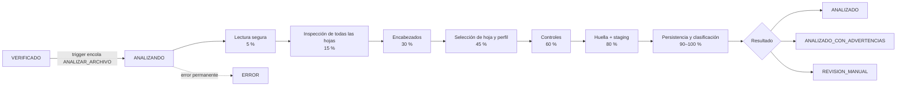

# Motor de análisis de archivos (FASE 3)

> Convierte un Excel **verificado** en una estructura técnica normalizada y auditable: hojas, encabezados, perfil documental, controles, staging de registros y **huella lógica de contenido**.
>
> **No** concilia RRHH contra Tesorería ni asocia personas (FASE 4 en adelante).
>
> **Versiones:** motor `1.0` · reglas `1` · huella `1`. Código en `app/Engine/Analysis/` y `app/Engine/Workbook/` (puro, sin base de datos) y `app/Engine/Jobs/AnalyzeFileJob.php` (persistencia), dentro del procesador en segundo plano (`bin/worker.php`). Hasta la versión 0.1.0-rc.2 este motor estaba escrito en Python; la versión PHP conserva las mismas reglas y versiones.

## 1. Proceso

**Encadenamiento.** Cuando el worker deja un archivo en `VERIFICADO`, el trigger `fn_archivo_encolar_analisis` (`SECURITY DEFINER`) encola `ANALIZAR_ARCHIVO` en la misma transacción. El worker no tiene `INSERT` sobre la cola.

**Reanálisis:**
- **Manual** (`analisis.reprocesar`), o por una decisión manual de hoja o perfil.
- **Sólo en estados analizables:** `VERIFICADO`, `ANALIZADO`, `ANALIZADO_CON_ADVERTENCIAS` o `REVISION_MANUAL`.
- **Condiciones:** que no haya otro análisis pendiente y que el lote y el periodo estén abiertos.

**Idempotencia:**
- Un trabajo sólo procesa si `archivos_importados.proceso_id` es él mismo; si hay un reanálisis más nuevo, el anterior se omite.
- Si ya persistió su análisis (por ejemplo, perdió el lease después del `COMMIT`), no hace nada.
- Persistir un análisis:
  - marca el anterior como `vigente = false`;
  - **borra** sus derivados (hojas, columnas, controles y staging);
  - inserta los nuevos en **una sola transacción**.

  El historial (`analisis_archivo`) conserva cada corrida sin duplicar datos.

**Reanálisis fallido:** si el reanálisis de un archivo que ya tenía análisis falla o se cancela, el archivo **conserva** su análisis vigente y su resultado. Sólo un archivo sin análisis previo queda en `ERROR`.

**Reintentos:**
- **Permanentes** (no se reintentan): `ARCHIVO_CORRUPTO`, `FORMATO_NO_COMPATIBLE`, `ESTRUCTURA_ILEGIBLE`, `ESTRUCTURA_EXCESIVA`, `TIEMPO_EXCEDIDO`, `INTEGRIDAD_FALLIDA`, `ANALISIS_INCONSISTENTE` y `ALMACENAMIENTO_INVALIDO`.
- **Transitorios:** BD caída y `ORIGINAL_NO_DISPONIBLE`. Siguen la política de la cola (reintentos acotados con *backoff*).
- En ambos casos el trigger `fn_proceso_a_archivo` deja el archivo en `ERROR`, que se puede reprocesar.

## 2. Librerías y lectura segura

| Formato | Lector | Por qué |
|---|---|---|
| `.xlsx` / `.xlsm` | **Lector OOXML propio** (`app/Engine/Workbook/OoxmlReader.php` y `XmlEvents.php`): ZIP en sólo lectura + `XMLReader` en streaming (`LIBXML_NONET`; cualquier DTD se rechaza) | Obtiene en **una sola pasada**, por celda, la **fórmula y su valor cacheado**, además de filas y columnas ocultas, AutoFiltro, `filterMode`, celdas combinadas, estado de hoja (`hidden` y `veryHidden`), vínculos externos y nombres definidos |
| `.xls` | PhpSpreadsheet 5.9 (`Reader\Xls`, sólo lectura, sin celdas vacías; `app/Engine/Workbook/XlsReader.php`) | Parser BIFF: expone filas y columnas ocultas, hojas ocultas y combinadas. Las fórmulas no se evalúan: se usan los valores almacenados. **No expone el texto de las fórmulas**: `tiene_formulas = NULL` y aviso `FORMULAS_NO_DISPONIBLES_XLS` |
| Utilidades | Propias: `DateFormat.php` (formatos de fecha), `Coordinates.php` y `FormulaTranslator.php` (fórmulas compartidas, sólo texto) | No abren libros |

**Por qué un lector OOXML propio y no PhpSpreadsheet para `.xlsx`/`.xlsm`:**
- Una sola pasada en streaming entrega la fórmula y su valor cacheado, además de filas ocultas y filtro.
- PhpSpreadsheet carga el libro completo en memoria; sólo se usa para `.xls`, cuyo tamaño está acotado por el límite de carga.

El análisis es fila a fila y no necesita bibliotecas de tablas.

**Garantías:**
- El original **nunca** se escribe, convierte, recalcula ni renombra (hay prueba con el SHA-256 y el `mtime` antes y después).
- **Nunca** se ejecuta VBA: `vbaProject.bin` sólo se detecta por nombre y el análisis no recurre a LibreOffice ni a Excel.
- **Nunca** se resuelven vínculos externos, DDE ni hipervínculos, y el análisis no accede a la red.

**Límites** (además de los de la FASE 2), configurables en `configuracion`:
- `analisis.max_celdas`: 1 000 000 celdas con valor por libro (máximo configurable 2 000 000); cuenta también las cadenas compartidas. Toda `<c>` o celda en blanco con formato cuenta contra 4 × ese valor. Si se excede → `ESTRUCTURA_EXCESIVA`.
- Tope de bytes por parte XML (`importacion.xml_max_mb`), verificado mientras se lee. El XML se lee en streaming con `XMLReader` y no se conserva el árbol, así que la memoria no crece con partes enormes (celdas combinadas, hipervínculos, relaciones). Topes: 100 000 celdas combinadas y 10 000 relaciones por parte.
- Fórmulas de más de 8 192 caracteres (el máximo de Excel) → `ESTRUCTURA_EXCESIVA`. Las fórmulas compartidas sólo se traducen si son `SUM`/`SUBTOTAL` cortas.
- `analisis.timeout_segundos` (900): el timeout y el lease se revisan cada 20 000 eventos XML (sin depender de los números de fila del archivo) y cada 2 000 filas en XLS. Además hay un **tope duro** (`set_time_limit`: plazo del trabajo + 60 s). Exceder el tiempo es un error **permanente**.
- Antes de leer, se vuelven a comprobar el **tamaño y el SHA-256** del original (`INTEGRIDAD_FALLIDA`).
- Entre dos análisis manuales del mismo archivo hay una espera mínima (`analisis.reanalisis_espera_segundos`, 30 s).

## 3. Inspección de todas las hojas

Se analizan **todas** las hojas: nunca se asume que la válida sea `Hoja1` ni la primera visible.

Por cada hoja se registra en `archivo_hojas`:
- visibilidad (`VISIBLE`, `OCULTA` o `MUY_OCULTA`), filas y columnas con datos, rango usado real y dimensión declarada;
- celdas no vacías, filtros, filas y columnas ocultas, fórmulas (cantidad y sin caché) y celdas combinadas;
- encabezado (fila y niveles), perfil sugerido, puntaje, estado, motivo y conteo de filas de detalle y TOTAL.

Estados de la hoja:

| Estado | Significado |
|---|---|
| `SELECCIONADA` | Hoja principal del documento |
| `INCLUIDA` | Otra hoja del mismo documento (perfiles multi-hoja: póliza de egreso) |
| `AUXILIAR` | Hoja complementaria (por ejemplo, la póliza GLOBAL embebida en el tabulado): se analiza y da controles cruzados, pero no entra a la huella |
| `CANDIDATA` | Coincide con el perfil y tiene registros, pero no fue elegida (queda en revisión) |
| `DESCARTADA` | No coincide con ningún perfil, o es una plantilla o bloque sin registros |
| `VACIA` | Sin celdas con datos |

## 4. Encabezados

Sobre las primeras 30 filas con datos (`app/Engine/Analysis/HeaderDetector.php`):
1. **Candidata:** fila con al menos 2 celdas no vacías, de las que al menos el 60 % sea texto no numérico.
2. **Puntaje:** 5 × etiquetas conocidas del vocabulario de perfiles (o de tipo concepto `NNN DESCRIPCIÓN`), más el número de textos, más 3 si la siguiente fila con datos tiene números, menos 2 si es un título combinado de ancho completo.
3. **Gana el mayor puntaje;** en empate, la fila más arriba (determinista).
4. **Dos niveles:** si la fila anterior tiene celdas combinadas horizontales sobre columnas del encabezado, el nombre queda como `GRUPO / SUBENCABEZADO`. Si una celda está vacía y la de arriba, combinada verticalmente, tiene texto, se usa esa.

   El emparejamiento con perfiles prueba el nombre compuesto y el del propio nivel.

**Normalización para análisis** (`norm_header`):
- se quitan los invisibles (anchura cero, bidi, controles y guion suave) y los acentos;
- se pasa a mayúsculas;
- `_ - /` se convierten en espacio y se elimina la puntuación;
- los espacios y saltos de línea se colapsan.

Ejemplos: `R.F.C.` → `RFC`; `Núm.` → `NUM`; `ID_CONCEPTO` → `ID CONCEPTO`.

El **encabezado original** se conserva en `archivo_columnas.encabezado_original`.

Filas **encima** del encabezado (títulos y metadatos):
- no entran a la huella;
- sólo se usan como señal débil de variante en la póliza GLOBAL;
- en la hoja no se guardan sus valores.

## 5. Perfiles

El perfil se detecta por **encabezados, estructura y contenido**. El nombre del archivo **no** se usa. Las reglas son declarativas y versionadas (`app/Engine/Analysis/Profiles.php`, reglas v1):

| Perfil | Familia | Requeridos (normalizados) | Variante por contenido |
|---|---|---|---|
| `TESORERIA_SANTANDER` / `TESORERIA_PENSION_SANTANDER` | `TESORERIA_SANTANDER` | NUMERO EMPLEADO, APELLIDO PATERNO…, NOMBRE DEL EMPLEADO, CUENTA, IMPORTE | Columna `ID_CONCEPTO`: palabra `NOMINA` o `PENSION` (≥ 90 % de los valores con señal) |
| `TESORERIA_INTERBANCARIA` / `TESORERIA_PENSION_INTERBANCARIA` | `TESORERIA_INTERBANCARIA` | CUENTA DE CARGO, CUENTA DE ABONO, BANCO RECEPTOR, BENEFICIARIO, IMPORTE | Columna `CONCEPTO` (ídem) |
| `TESORERIA_BBVA` | propia | NUM, NOMBRE, RFC, IMPORTE, CTA BBVA | — |
| `TESORERIA_PENSION_BBVA` | propia | NUM, NOMBRE, TOTAL (importe), CUENTA | — |
| `RRHH_TABULADO_POLICIA` / `RRHH_TABULADO_BOMBEROS` | `RRHH_TABULADO` | NUM, NOMBRE, RFC, CURP, PERCEP, DEDUC, TOTAL (+ columnas `NNN CONCEPTO`) | Valores de `AREA`, `CARGO` y `DEPTO` (`POLICI` o `SEGURIDAD PUBLICA` frente a `BOMBER`) en ≥ 50 % de las filas; si no, título (confianza MEDIA) |
| `RRHH_POLIZA_GLOBAL_POLICIA` / `…_BOMBEROS` | `RRHH_POLIZA_GLOBAL` | Bloques `PERCEPCIONES`/`DEDUCCIONES` (código, descripción, importe) y pie `TOTAL PERCEPCIONES`, `TOTAL DEDUCCIONES`, `NETO`, `Cantidad de Empleados` | Título del libro (**confianza MEDIA**: es la única señal disponible; ver H-04) |
| `POLIZA_EGRESO_BANCARIA` | propia, **multi-hoja** | CUENTA, SCTA, CONCEPTO, DEBE, HABER | — |

Los antiguos `RRHH_TABULADO` y `RRHH_POLIZA_GLOBAL` quedan como familia documental inactiva.

**Puntaje de emparejamiento** (0–100) = 60 × cobertura de requeridos + 20 × cobertura de opcionales + 20 × (1 − proporción de columnas no reconocidas).
- **Emparejamiento fuerte:** cobertura de requeridos = 100 %.
- **Parcial:** ≥ 75 %. Deja el archivo en `REVISION_MANUAL` (`PERFIL_PARCIAL`).
- **Sin coincidencia:** no hay perfil.

**Confianza** (sin porcentajes falsamente precisos):

| Nivel | Cuándo |
|---|---|
| `ALTA` | Cobertura completa y variante decidida por contenido, o familia sin variantes |
| `MEDIA` | La variante sólo se pudo inferir del título |
| `BAJA` | Cobertura parcial o variante no determinada (va con `REVISION_MANUAL`) |
| `MANUAL` | Perfil elegido por un usuario |
| `NINGUNA` | Sin perfil (`PERFIL_DESCONOCIDO`) |

## 6. Filas: detalle, TOTAL y auxiliares

Clasificación de cada fila bajo el encabezado (`SheetScanner::classifyRows`):

| Clase | Regla |
|---|---|
| `AUXILIAR/FUERA_DE_TABLA` | Sin celdas en columnas de la tabla |
| `AUXILIAR/ENCABEZADO_REPETIDO` | Repite ≥ 60 % de los encabezados (hojas compuestas por bloques) |
| `TOTAL/SUMA` o `TOTAL/SUBTOTAL` | Alguna columna de importe tiene un `SUM`/`SUBTOTAL` **vertical**, es decir, sobre un rango de varias filas. Un `SUM` horizontal de la misma fila (por ejemplo, percepciones = `SUM(R5:Z5)`) **no** es total, ni un `SUBTOTAL` con función distinta de 9 o 109 (conteo, promedio…) |
| `DETALLE` | Tiene identificadores reales (número, nombre, cuenta, CLABE…). En la póliza de egreso, además, algún importe numérico; o un importe inválido en una línea contable real (código de cuenta numérico), que se cuenta en `IMPORTES_INVALIDOS`. Un título de sección sin cuenta es `AUXILIAR/SIN_IMPORTES` |
| `AUXILIAR/CALCULO` | Sin identificadores y con una fórmula que no agrega (por ejemplo `=L-M` o `=W+Z`) |
| `TOTAL/CONSTANTE` | Sin identificadores y con un importe numérico: **una fila TOTAL no necesita decir TOTAL** |
| `TOTAL/PALABRA_CLAVE` | Sin identificadores, con `TOTAL`, `SUMA`, `SUBTOTAL`… y un importe inválido (queda `TOTAL_INVALIDO`) |

Reglas adicionales:
- Un identificador que contiene sólo una palabra de total (por ejemplo `NOMBRE = "TOTAL"`) no cuenta como identificador.
- Las filas TOTAL **se excluyen del detalle** (nunca entran a staging ni a la huella) y **se usan como control**.
- Pueden aparecer en cualquier posición y más de una vez.

## 7. Controles (`controles_archivo`)

Son genéricos (no sólo monetarios: `tipo_valor` puede ser `MONEDA` o `ENTERO`) y siempre usan aritmética decimal exacta (`bcmath`, `app/Engine/Support/Dec.php`), nunca `float`. Cada control guarda:
- valor declarado, valor calculado, diferencia y tolerancia (`conciliacion.tolerancia_monetaria`);
- estado, filas de evidencia (hasta 20), mensaje y detalle (sin datos de personas).

Las **sumas** se hacen con la precisión completa de cada celda (representación decimal más corta del valor almacenado, `Dec::fromFloat`) y se cuantizan **una sola vez** a 0.01 con `ROUND_HALF_UP`, igual que el `SUM` de Excel. Cuantizar fila por fila producía diferencias falsas de centavos.

| Control | Qué compara |
|---|---|
| `TOTAL_IMPORTE`, `TOTAL_NETO`, `TOTAL_PERCEPCIONES`, `TOTAL_DEDUCCIONES` | Fila TOTAL frente a suma del detalle, por columna de importe |
| `CANTIDAD_FILAS_DETALLE`, `CANTIDAD_FILAS_TOTAL`, `FILAS_DETALLE_OCULTAS` | Conteos (`NO_APLICA`, informativos) |
| `IMPORTES_INVALIDOS` | Importes no interpretables en el detalle: **nunca se toman como cero** |
| `IMPORTES_NEGATIVOS` | Informativo |
| `TOTALES_CONCEPTOS` | Tabulado: total de cada columna `NNN` frente a su suma |
| `CONSISTENCIA_NETO_FILAS` | Tabulado: percepciones + deducciones = neto, por fila (acepta deducciones negativas o positivas) |
| `NETO_VS_POLIZA_GLOBAL`, `EMPLEADOS_VS_POLIZA_GLOBAL` | Tabulado frente a la póliza GLOBAL del mismo libro. Si el tabulado es una vista filtrada, reconoce la base **filas visibles** |
| `TOTAL_PERCEPCIONES`, `TOTAL_DEDUCCIONES`, `NETO`, `CANTIDAD_EMPLEADOS_DECLARADOS` | Póliza GLOBAL. Reconoce la **convención de signo** cuando las deducciones vienen en negativo |
| `CUADRE_DEBE_HABER` | Póliza de egreso: última fila de "sumas" con `SUM` vertical en DEBE y HABER. En una hoja compuesta por bloques sin fila final queda `NO_APLICA` ("no determinable"), nunca un `NO_CUADRA` falso |
| `FORMULAS_SUMA_VERIFICADAS` | Cada `SUM`/`SUBTOTAL` vertical de una columna se **re-suma en decimal exacto** sobre su rango y se compara con su valor **cacheado** (nunca se recalcula el libro). Las fórmulas compartidas se traducen a su celda. `SUBTOTAL` omite las filas ocultas (aproximación: el formato no distingue las ocultas por filtro de las ocultas a mano) |

**Estados de un control de total:**

| Estado | Regla |
|---|---|
| `SIN_TOTAL` | No hay filas TOTAL. Es un caso real legítimo |
| `TOTAL_INVALIDO` | La fila TOTAL es una fórmula **sin valor cacheado** (`FORMULA_SIN_VALOR_CACHE`), no es numérica, o es negativa cuando el detalle es positivo |
| `CUADRA` | Un único valor declarado (aunque se repita en varias filas iguales) con \|declarado − detalle\| ≤ tolerancia. Si no coincide y la hoja tiene filas ocultas o el total es un `SUBTOTAL`, se compara con las **filas visibles** (base `FILAS_VISIBLES`) |
| `MULTIPLES_TOTALES` | Varios valores distintos cuyo último no equivale al total (si equivale, es `CUADRA` con subtotales intermedios) |
| `NO_CUADRA` | La diferencia excede la tolerancia |
| `NO_APLICA` | Control informativo o no determinable |

## 8. Huella lógica de contenido v1

**Objetivo:** detectar que dos binarios distintos contienen **el mismo detalle relevante**, sin ocultar diferencias reales.

**Qué entra:**
- Las filas `DETALLE` de la(s) hoja(s) seleccionada(s), tanto visibles como **ocultas** (un filtro de vista no cambia el contenido).
- Por fila:
  - los campos del perfil con `huella = True`;
  - las columnas de concepto `NNN`;
  - toda otra columna **con encabezado** (`X:<encabezado normalizado>`).
- El código del perfil.
- En perfiles multi-hoja, el nombre normalizado de cada hoja.

**Qué NO entra:**
- **Filas:** TOTAL y SUBTOTAL, vacías y auxiliares (cálculos, notas, fuera de tabla, encabezados repetidos).
- **Columnas:** las que no tienen encabezado (auxiliares) y los campos técnicos del perfil (tipo de registro y número de secuencia de Santander, que cambian si se reordena).
- **Contenido fuera del detalle:** títulos y metadatos sobre el encabezado.
- **Presentación:** formato, estilos, anchos y orden de las hojas.
- **Datos del sistema:** nombre del archivo, ruta, UUID y fechas de carga.

**Normalización de valores:**

| Tipo | Valor en la huella |
|---|---|
| Dinero | Decimal exacto cuantizado como texto (`"1234.50"`) |
| Importe inválido | `"!INVALIDO:<texto>"` |
| Texto | NFC, sin invisibles, espacios colapsados. **Conserva mayúsculas y acentos:** un cambio de captura es una diferencia |
| Identificadores | Texto sin espacios, con los ceros iniciales cuando vienen como texto |
| Cuentas y CLABE | Sólo dígitos |
| Fechas | ISO |
| Vacío | `null` |

**Orden y serialización:**
1. En los perfiles v1 el orden de las filas no es contenido, así que los registros se ordenan por su serialización canónica. Si un perfil declara `order_significant`, se conserva el orden original.
2. El documento completo es un **JSON canónico**: `{"v":1, "perfil":…, "hojas":[{"hoja":null|nombre, "campos":[…ordenados…], "registros":[[…],…]}]}`, en UTF-8, con claves ordenadas y sin espacios.
3. Se calcula su SHA-256.

La representación canónica **sólo existe en memoria**: contiene cuentas completas y nunca se persiste.

**Versionado:**
- `huella_version = 1`. Cambiar el algoritmo exige la versión 2.
- La BD sólo permite fijar la huella **al cerrar un análisis**. Si con la misma versión sale una huella distinta a la última registrada (otra hoja o perfil elegidos, otro margen de ambigüedad, un ajuste del motor), el análisis se acepta pero queda `ANALIZADO_CON_ADVERTENCIAS` con `HUELLA_DISTINTA_MISMA_VERSION` y la huella anterior en la auditoría. Nunca se sobrescribe en silencio ni bloquea el archivo.
- Una selección manual de hoja o perfil **invalida** la huella (trigger), que el nuevo análisis vuelve a calcular.

## 9. Clasificación entre archivos

| Clasificación | Regla |
|---|---|
| `DUPLICADO_BINARIO` | Mismo SHA-256 (asignado al cargar; se conserva) |
| `DUPLICADO_CONTENIDO` | Distinto SHA-256 y **misma huella v1** que un archivo cargado **antes** (id menor) y no anulado |
| `POSIBLE_VERSION` | Mismo **periodo** y **perfil**, encabezados con Jaccard ≥ 0.8 y, además, ≥ 50 % de registros idénticos (`hash_registro`) **o** ≥ 80 % de la **misma población** por clave del perfil (`clave_hash`: empleado + cuenta, CLABE, empleado, código de concepto). Una estructura parecida con **otras personas** no basta |
| `NUEVO` | Ninguna de las anteriores |
| `SIN_HUELLA` | Hay análisis, pero no perfil con el cual calcular la huella |
| `REVISION_MANUAL` | El análisis quedó en revisión |

Reglas adicionales:
- La clasificación es **determinista y estable**: sólo se compara con archivos anteriores, así que reanalizar el primero no lo convierte en duplicado del segundo.
- Es sólo una **sugerencia**: ningún archivo reemplaza a otro automáticamente.
- Cada cambio se audita (`archivos.clasificar_contenido`) con su evidencia: Jaccard, registros y claves en común.

**Comparación técnica A contra B** (`/importaciones/{id}/comparar?con={id}`):
- muestra SHA-256, huella, perfil, hojas, hoja principal, registros y columnas (sólo en A y sólo en B) y los controles lado a lado;
- incluye registros idénticos y con la misma clave;
- **no** hace diff persona por persona (FASE 4 en adelante).

## 10. Selección de hoja y revisión manual

**Puntaje de cada hoja candidata** (0–100). El detalle se guarda en `metadata.puntaje_detalle`, que se ve al pasar el cursor por la columna "Puntaje":

| Componente | Puntos |
|---|---|
| Emparejamiento con el perfil | 0.6 × puntaje del perfil (máximo 60) |
| Tiene registros de detalle | +15 (sin registros: −15; sólo totales: −30) |
| Identificadores completos | +10 si ≥ 90 %, +5 si ≥ 50 % |
| Importes numéricos | +10 si ≥ 95 % |
| Filas ocultas en el detalle | −15 |
| Filtro | −10 |
| Hoja oculta o muy oculta | −10 |
| Encabezado desplazado (fila > 20) | −5 |

**Algoritmo** (`engine._select`):
1. Hojas candidatas: coinciden con un perfil y tienen registros.
2. Si hay familias **distintas** que no son complementarias entre sí (por ejemplo, un libro de trabajo con copias de dispersión y de tabulado) → `REVISION_MANUAL` (`LIBRO_CON_PERFILES_DISTINTOS`).
3. En un perfil **multi-hoja** (póliza de egreso), todas las hojas del perfil forman el documento; la principal es la de menor índice.
4. Si la diferencia entre la primera y la segunda hoja es ≥ `analisis.margen_ambiguedad` (10), gana la primera.
5. Si la diferencia es menor:
   - se consideran **todas** las hojas dentro del margen. La fuente es la de más registros (preferentemente completa y sin filtros);
   - cada una de las demás debe tener el **mismo detalle** o ser un **subconjunto filtrado** de la fuente;
   - si alguna tiene contenido distinto, `REVISION_MANUAL` (`AMBIGUEDAD_HOJAS`). **Nunca** se elige arbitrariamente.

**Hojas filtradas:** una hoja con filas ocultas **no** se elige si existe otra equivalente completa. Pero tampoco se descarta siempre: si es la única fuente, se analiza con la advertencia `VISTA_DERIVADA` (`ANALIZADO_CON_ADVERTENCIAS`).

**Decisión manual:** un usuario con `analisis.seleccionar_hoja` o `analisis.seleccionar_perfil` elige la hoja o el perfil, o vuelve a la selección automática.
1. Debe dar un **motivo**.
2. La decisión se guarda en `archivos_importados` (`hoja_manual_*`, `perfil_manual_id`, `seleccion_manual_por` y `…_at`).
3. El trigger **invalida la huella** y la clasificación por contenido.
4. Se encola un nuevo análisis y todo se audita.

Los datos originales nunca se editan. CONSULTA no puede tomar decisiones.

## 11. Staging (`staging_registros`)

Una fila por **registro de detalle**. No es EAV ni guarda cada celda.

| Columna | Contenido |
|---|---|
| Trazabilidad | `archivo_id`, `hoja_id` y `fila_origen` (base 1, como en Excel) |
| Estado de la fila | `oculta` |
| Importe principal | `importe` en `NUMERIC(14,2)` e `importe_estado` (`OK`, `VACIO`, `INVALIDO` o `NO_APLICA`) |
| Datos | `datos` en jsonb: los campos normalizados del perfil y las columnas `NNN`. Las cuentas se enmascaran como `****1234` |
| Cuenta principal | `cuenta_hmac`, HMAC-SHA256 con `ACCOUNT_HMAC_KEY` y el mismo algoritmo que PHP, más `cuenta_ultimos4`. **La cuenta completa no se guarda** (su cifrado AES-GCM llega en la FASE 5 desde el original, que se conserva) |
| Hashes | `hash_registro` (registro canónico) y `clave_hash` (clave del perfil) para comparar versiones. Son **HMAC** con una llave derivada de `ACCOUNT_HMAC_KEY`: un SHA-256 sin llave de un registro corto permitiría recuperar la cuenta por fuerza bruta. Si se rota la llave, hay que reanalizar para seguir comparando |

Los nombres, RFC y CURP están en `datos`, porque la FASE 4 los necesita para asociar. El rol web **no puede leer** `datos` ni el HMAC (privilegios por columna). Nunca aparecen en logs, en la auditoría, en errores ni en la interfaz: **no hay vista previa de filas**. Las columnas no reconocidas con aspecto de cuenta se enmascaran.

## 12. Seguridad y observabilidad

- **Detecciones** (se reportan, nunca se resuelven):
  - fórmulas con referencias externas `[n]` y fórmulas con patrón DDE (`app|'tema'!celda`);
  - partes `externalLink` (DDE y OLE), relaciones `TargetMode="External"` e hipervínculos externos;
  - nombres definidos que apuntan fuera (`[n]`, `|`, `http://`, UNC);
  - macros.

  Todas quedan como advertencias en el análisis.
- **Errores:** las excepciones inesperadas se convierten en `ESTRUCTURA_ILEGIBLE`. Sólo se guardan el tipo de excepción y la línea del código del motor: nunca el mensaje, que podría contener valores de celdas.
- **Logs:** se registran `archivo_id`, `proceso_id`, fases, duraciones (`lectura_ms`, `hojas_ms`, …), `rss_max_kb`, celdas, filas y el resultado. Nunca nombres, RFC, CURP, CLABE ni cuentas.
- **Auditoría** (origen `WORKER`): perfil, confianza, hoja, filas de detalle, las primeras 16 posiciones de la huella, códigos de advertencia y estados de los controles. Sin contenido de celdas.
- **Interfaz** (`/importaciones/{id}`, sección "Análisis del archivo"):
  - `analisis.ver`: resultado, perfil, confianza, relación, advertencias y controles.
  - `analisis.ver_diagnostico` agrega hojas, puntajes, encabezados, metadatos de columnas, historial y comparación.
  - Ningún rol ve filas de datos.

## 14. Limitaciones conocidas

1. **`.xls`:** el lector no expone el texto de las fórmulas. `tiene_formulas` y `FORMULAS_SUMA_VERIFICADAS` no aplican, y el AutoFiltro se infiere de `_FilterDatabase`.
2. **`SUBTOTAL`:** al re-sumar se omiten todas las filas ocultas (no se distinguen las ocultas por filtro de las ocultas a mano).
3. **Póliza GLOBAL:** la variante (policía o bomberos) sale del título, así que su confianza es MEDIA. Un título engañoso produciría una variante equivocada con advertencia `VARIANTE_POR_TITULO`.
4. **Pólizas de egreso compuestas por bloques** sin fila final de sumas: el cuadre global queda `NO_APLICA`, y se verifican las sumas de cada bloque.
5. **Huella:** es sensible a cambios de mayúsculas y acentos en textos (decisión conservadora: nunca oculta diferencias). Dos capturas equivalentes que difieran en capitalización quedan como `POSIBLE_VERSION`, no como duplicado.
6. **Límite de celdas:** con 1 000 000 celdas por libro, un libro legítimo más grande requiere que GOD ajuste `analisis.max_celdas`.
7. **Libros de trabajo del analista** (hojas DISPERSADA, TABULADA, COTEJADA): siempre quedan en `REVISION_MANUAL`. No son fuente primaria.
