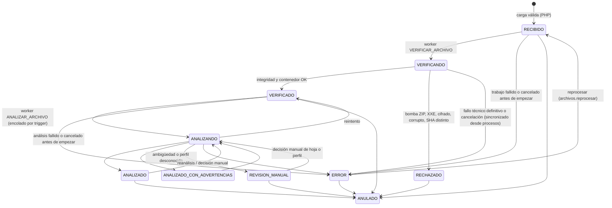
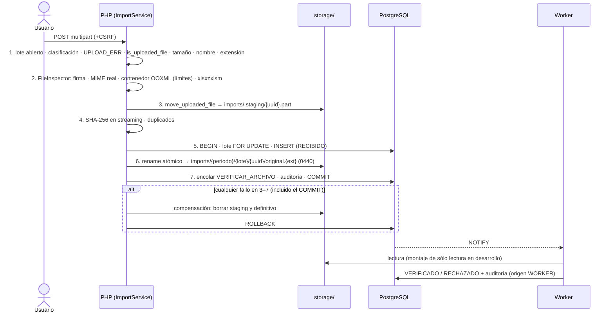

# Importaciones — ConciliaRH

> **Estado:** FASE 2 (periodos, lotes, carga segura, almacenamiento inmutable, verificación) y FASE 3 (análisis del libro, controles, huella lógica y clasificación entre archivos) implementadas. El motor de análisis se documenta en **`docs/FILE_ANALYSIS.md`**.
> La **lectura de celdas**, la detección de perfil y la **huella de contenido** corresponden a la FASE 3.

## 1. Conceptos

```
PERIODO (año · mes · quincena · tipo)
  └─ LOTE "Carga 001", "Carga 002"…      ← una entrega; los lotes nunca se mezclan en una conciliación
       └─ ARCHIVO importado                ← original inmutable + metadatos + clasificación
            ├─ TIPO DOCUMENTAL             (qué es: RRHH_TABULADO, RRHH_POLIZA_GLOBAL, POLIZA_EGRESO_BANCARIA, TESORERIA_DISPERSION…)
            ├─ ORIGEN ADMINISTRATIVO       (quién lo emite: SIN_DEFINIR, RRHH, TESORERIA, CONTABILIDAD, OTRO)
            └─ PERFIL DE IMPORTACIÓN       (cómo se lee: TESORERIA_SANTANDER, TESORERIA_INTERBANCARIA…; FASE 3)
```

Tipo, origen y perfil son **independientes**:
- Una `POLIZA_EGRESO_BANCARIA` no se asume de Tesorería: su origen queda `SIN_DEFINIR` hasta que alguien lo clasifique.
- El perfil se detectará **por encabezados y contenido**, nunca por el nombre del archivo.

## 2. Archivo binario ≠ contenido lógico

| Huella | Qué identifica | Cuándo se calcula | Uso |
|---|---|---|---|
| **SHA-256 binario** (`sha256`) | El archivo **exacto**, byte a byte | Al recibirlo (PHP, en streaming) | Integridad del original, duplicado exacto (`DUPLICADO_BINARIO`) y verificación en cada descarga |
| **Huella de contenido** (`huella_contenido`, `huella_version`) | Los **datos normalizados relevantes** (registros de detalle), sin importar formato, orden de filas u hojas, estilos ni filas TOTAL agregadas | Al analizar el libro (`ANALIZAR_ARCHIVO`, FASE 3) | `DUPLICADO_CONTENIDO` (mismos datos en otro binario) y `POSIBLE_VERSION` (mismo documento con diferencias) |

**Caso observado en operación:** archivos con **el mismo nombre y distinto SHA-256** pueden tener un detalle de pagos **idéntico** (p. ej., sólo difieren en una **fila TOTAL agregada**). Sólo el SHA-256 no basta, pero tampoco debe unir automáticamente dos binarios distintos.

**Contrato de la huella de contenido** (implementado en la FASE 3 como `HUELLA_CONTENIDO_V1`; qué entra y qué no, en `FILE_ANALYSIS.md` §8):
1. La calcula el procesador en segundo plano (`app/Engine/Analysis/Fingerprint.php`) a partir de los registros **normalizados**, en este orden:
   1. identificadores normalizados;
   2. importes decimales exactos cuantizados a 0.01 en texto canónico;
   3. conceptos por código.
2. Las filas TOTAL se **excluyen** de la huella; se registran aparte como control (`controles_archivo`).
3. Los registros se ordenan de forma determinística y se serializan como JSON canónico (UTF-8, claves ordenadas, sin espacios). Sobre ese JSON se calcula SHA-256.
4. `huella_version` identifica el algoritmo. Un cambio de algoritmo exige una versión nueva; la BD impide cambiar la huella sin cambiar la versión.
5. La huella no contiene datos personales legibles: es un hash.

**Clasificación de duplicidad** (`clasificacion_duplicidad`, nunca una sola bandera):

| Valor | Significado | Quién lo asigna |
|---|---|---|
| `PENDIENTE` | Binario nuevo; contenido aún no analizado | Carga (FASE 2) |
| `DUPLICADO_BINARIO` | Mismo SHA-256 que otro archivo vigente (enlazado en `archivo_relacionado_id`) | Carga, **sólo con confirmación explícita** si está en otro lote |
| `NUEVO` | Contenido no visto antes | Análisis (FASE 3) |
| `DUPLICADO_CONTENIDO` | Distinto binario, misma huella de contenido que un archivo cargado ANTES | Análisis (FASE 3) |
| `POSIBLE_VERSION` | Mismo periodo y perfil, estructura igual y registros idénticos (≥ 50 %) o misma población por clave (≥ 80 %), con contenido distinto | Análisis (FASE 3). **La decisión de reemplazo es humana** |
| `SIN_HUELLA` | Analizado sin perfil con el cual calcular la huella | Análisis (FASE 3) |
| `REVISION_MANUAL` | El análisis quedó en revisión manual | Análisis (FASE 3) |

**Reglas de duplicado exacto:**
- En el **mismo lote**: rechazo `DUPLICADO_EXACTO_EN_LOTE`. Además lo impide un índice único `(lote_id, sha256)`.
- En **otro lote**: `DUPLICADO_EXACTO_REQUIERE_CONFIRMACION`. Con la casilla de confirmación se acepta como `DUPLICADO_BINARIO`. Es el caso real de los 4 archivos idénticos en ambas carpetas de la 1ra quincena.

## 3. Estados

### 3.1 Periodo

| Estado | Admite lotes y cargas | Transiciones |
|---|---|---|
| `ABIERTO` | Sí | → `CERRADO` (`periodos.cerrar`; cierra también sus lotes abiertos) · → `ANULADO` |
| `CERRADO` | No | → `ABIERTO` sólo por **reapertura excepcional** (`periodos.reabrir`, ADMIN o GOD, con motivo y auditada) |
| `ANULADO` | No | Final. Sólo sin archivos vigentes (`periodos.anular`, ADMIN o GOD); anula sus lotes |

"En proceso" o "Conciliado" **no** son estados del periodo: son resultados de la conciliación (FASE 6). Así se evitan dos fuentes de verdad.

- Año, mes, quincena y tipo son inmutables (privilegios por columna).
- La unicidad es `(año, mes, quincena, tipo)` con tipo `ORDINARIA` o `EXTRAORDINARIA`.

### 3.2 Lote

| Almacenado (ciclo de vida) | Derivado (`v_lotes_resumen.estado_procesamiento`) |
|---|---|
| `ABIERTO` → `CERRADO` (→ `ABIERTO` con `lotes.reabrir`: ADMIN o GOD) · `ANULADO` | `SIN_ARCHIVOS` · `PROCESANDO` · `CON_ERRORES` · `CON_ADVERTENCIAS` · `LISTO` |

- **Oficial:** `es_oficial` lo declara ADMIN o GOD (`lotes.declarar_oficial`, ya no exclusivo de GOD desde la migración 0026), con motivo. Retirar la marca anulando el lote exige el mismo permiso. Hay como máximo **un lote oficial por periodo** (índice único parcial).
- **Relación entre lotes:** en el detalle del lote (`/lotes/{id}`, permiso `lotes.relacionar`) se relaciona con otro lote como `CORRIGE`, `SUSTITUYE`, `COMPLEMENTA` o `RELACIONADO` (tabla `lotes_relaciones`, auditada; las relaciones se anulan, no se borran). Los campos antiguos `lote_relacionado_id`/`tipo_relacion` de `lotes_importacion` se conservan por compatibilidad.

### 3.3 Archivo (máquina de estados validada por trigger `fn_archivo_reglas`)



- Los rechazos **en la carga** (extensión, firma, MIME, contenedor peligroso…) **no crean registro ni archivo**. Se auditan como `archivos.rechazar_carga` con el código, la extensión y el **SHA-256 del nombre**, nunca el nombre legible: los nombres de nómina pueden contener datos personales y la bitácora es inalterable. Las cargas **aceptadas** sí guardan `nombre_original`, que es un metadato necesario para operar.
- **Quién fija cada estado (0009):** el rol web sólo puede llevar un archivo a `RECIBIDO` (reproceso) o a `ANULADO`. `VERIFICANDO`, `VERIFICADO`, `RECHAZADO`, `ANALIZANDO`, `ANALIZADO*` y `ERROR` los fija el motor o los triggers `SECURITY DEFINER`. Una inyección SQL o un bug en PHP no pueden "dar por verificado" un archivo.
- **Sincronización con la cola:** si un `VERIFICAR_ARCHIVO` termina en `ERROR` (incluso por el reaper antes de empezar) o se **cancela**, el archivo pasa a `ERROR` (`VERIFICACION_CANCELADA` en el segundo caso) y puede reprocesarse. Nunca queda atascado.
- **Anular** no se permite mientras la verificación está `EN_EJECUCION`; hay que esperar a que termine.
- **Reclasificar y reprocesar** exigen que el lote y el periodo sigan abiertos.
- **Lote:** sólo se anula sin archivos vigentes. Un lote **oficial** sólo lo anula GOD, porque retirar la marca es tan sensible como ponerla. `v_lotes_resumen` muestra `VERIFICADO` (verificado, pendiente de análisis) antes que `LISTO` (analizado).

## 4. Flujo de carga y estrategia transaccional



**Garantía:** PostgreSQL y el sistema de archivos no comparten transacción, así que:
- Todo fallo **capturable antes del COMMIT** se compensa (probado con un fallo simulado **después** del `rename`): no queda registro sin archivo ni archivo sin registro. La ruta definitiva sólo se reclama si no existía, así que nunca se borra un original ajeno.
- Si falla **el propio COMMIT**, el definitivo **no se borra**: el servidor pudo haberlo confirmado (p. ej. por una conexión perdida) y borrarlo dejaría un registro sin original. Si no se confirmó, queda un huérfano que detecta el verificador.
- La carga toma `FOR UPDATE` del lote y `FOR SHARE` del periodo. La anulación del periodo bloquea sus lotes antes de contar archivos, así que no puede anularse un periodo mientras entra un archivo.
- Una **caída abrupta** del proceso entre el paso 6 y el COMMIT puede dejar un archivo sin registro. Esa ventana la cierra el verificador de almacenamiento:

```bash
php bin/verificar-almacenamiento.php            # reporte: huérfanos, staging vencido, originales ausentes o alterados
php bin/verificar-almacenamiento.php --hash     # además recalcula SHA-256 de cada original
php bin/verificar-almacenamiento.php --cuarentena   # MUEVE (nunca borra) huérfanos a storage/cuarentena/
```

Se recomienda en cron diario. Sale con código 2 si hay hallazgos y los deja en `security-cli.log` (las CLI escriben `{canal}-cli.log`; la web, `{canal}.log`).
Sólo considera **huérfano** un archivo sin registro con más de 1 h de antigüedad: uno más reciente puede pertenecer a una carga aún sin COMMIT. Antes de mover cada archivo, la cuarentena **vuelve a consultar la BD** y nunca aparta un original registrado.

## 5. Almacenamiento

```
STORAGE_PATH/                       (fuera de public/, nunca servido por Apache)
├── imports/
│   ├── .staging/{uuid}.part         temporal durante la carga
│   └── {periodo_id}/{lote_id}/{uuid}/original.{xls|xlsx|xlsm}   ← original INMUTABLE (0440)
├── cuarentena/{fecha}/…            huérfanos movidos por el verificador
├── trabajo/                        copias de trabajo del motor (FASE 3); nunca el original
└── logs/
```

- **La ruta sólo usa enteros, un UUID v4 generado por el servidor y una extensión de lista blanca.** El nombre del usuario es un metadato (`nombre_original`), saneado: sin componentes de ruta, sin bytes nulos, sin controles ni caracteres bidi, normalizado a NFC y con un máximo de 200 caracteres.
- **Portabilidad:** la BD guarda la ruta **relativa**, validada por un `CHECK` con expresión regular.
- **Inmutabilidad:** el archivo queda en 0440. Un trigger impide cambiar SHA-256, ruta, tamaño, extensión, firma, nombre, lote o autor, **incluso al propietario**. El worker monta `storage/imports` en **sólo lectura** (desarrollo).
- **Descarga:** sólo por `POST /importaciones/{id}/descargar` con CSRF (`archivos.descargar_original`, que tienen ADMIN y GOD). Es POST porque tiene efecto (auditoría) y no debe dispararse desde un enlace de otro sitio.
  - Los archivos `RECHAZADO` (contenedor peligroso, cifrado, corrupto) **no se descargan**.
  - Un libro **con macros** exige confirmar explícitamente (`confirmar_macros=1`) tras un aviso. ConciliaRH nunca ejecuta macros, pero Excel podría hacerlo al abrir el archivo.
  - Antes de servir el archivo se verifican de nuevo el tamaño y el SHA-256; si no coinciden, error 409 `INTEGRIDAD_ERROR` y alerta.
  - Toda descarga se audita.
  - Cabeceras: `Content-Disposition: attachment` (nombre ASCII y `filename*` UTF-8), `nosniff`, `CSP: default-src 'none'; sandbox`, `no-store`.

## 6. Límites (fuente única y coherente)

| Capa | Valor por omisión | Dónde |
|---|---|---|
| Aplicación: tamaño del archivo | `MAX_UPLOAD_SIZE` = 25 MiB | `.env` → `config/app.php` |
| PHP | `upload_max_filesize = 26M`, `post_max_size = 30M` (ligeramente mayores para que la app emita `UPLOAD_DEMASIADO_GRANDE`) | `php.ini` (`infra/docker/php/conciliarh.ini` en desarrollo) |
| Apache | `LimitRequestBody 33554432` (32 MiB) | vhost |
| Cuerpo mayor que `post_max_size` | Respuesta **413** `UPLOAD_DEMASIADO_GRANDE` (en lugar de un falso error CSRF) | `Request::exceededPostMaxSize()` |
| Entradas del contenedor OOXML | 5000 | `configuracion.importacion.zip_max_entradas` |
| Descomprimido total | 300 MB | `…zip_max_descomprimido_mb` |
| Relación de compresión por entrada > 1 MB | 150 | `…zip_max_ratio` (holgado frente a los libros legítimos observados) |
| Parte XML | 200 MB | `…xml_max_mb` |

Al cambiar `MAX_UPLOAD_SIZE` en producción, ajuste `upload_max_filesize` (≥ MAX + 1 MB), `post_max_size` (≥ upload + 4 MB) y `LimitRequestBody` (≥ post_max_size).

## 7. Doble verificación de seguridad

| Control | Web PHP (antes de almacenar) | Procesador `VERIFICAR_ARCHIVO` (después; `app/Engine/Files/ContainerVerifier.php`) |
|---|---|---|
| Firma (magic bytes) | ✅ OLE2 / ZIP coherente con la extensión | ✅ |
| MIME real (`finfo`) | ✅ lista blanca por extensión | — |
| SHA-256 y tamaño del original almacenado | — (se calcula) | ✅ se recalcula y compara |
| Rutas internas `..`, absolutas, `\` o NUL | ✅ | ✅ |
| Entradas, tamaño y ratio | ✅ con tamaños **declarados** | ✅ **descompresión real en streaming con tope** (no confía en la cabecera) |
| `DOCTYPE` / `ENTITY` (XXE, *billion laughs*) | ✅ `[Content_Types].xml` | ✅ **todas** las partes XML, detectadas **por contenido** (no sólo por extensión: `[Content_Types].xml` puede declarar XML cualquier extensión), incluso entre bloques |
| Codificación UTF-16/UTF-32 en partes | — | ✅ rechazada (Excel escribe UTF-8; un filtro de bytes no vería un DOCTYPE en otra codificación) |
| Entradas ZIP cifradas | — | ✅ |
| xlsx ↔ xlsm | ✅ parte principal del libro + `vbaProject.bin` | ✅ |
| OLE2 (`.xls`) | Firma + MIME | ✅ lector OLE2/CFB propio (`CompoundFile.php`): estructura, `Workbook`/`Book`, paquete cifrado (`EncryptedPackage`), **cifrado BIFF (`FILEPASS`, RC4/XOR)**, VBA |
| Tiempo | — | ✅ el timeout del trabajo y el lease se revisan **durante** la descompresión (cada 4 MiB) |

**Macros:** los `.xlsm` y los `.xls` con VBA se aceptan **sólo como datos**. Nunca se abren con Excel ni con LibreOffice y ningún componente del sistema ejecuta VBA: se usan parsers en PHP (ZIP, OLE2/CFB propio, lector OOXML propio con XMLReader y PhpSpreadsheet para `.xls`), que no ejecutan macros. `tiene_macros` se registra como metadato.

## 8. Códigos de error

| Código | Causa | Registro/archivo |
|---|---|---|
| `UPLOAD_SIN_ARCHIVO` | No se seleccionó archivo | No |
| `UPLOAD_DEMASIADO_GRANDE` | Excede `MAX_UPLOAD_SIZE`, `upload_max_filesize` o `post_max_size` (413) | No |
| `UPLOAD_INCOMPLETO` | Carga interrumpida | No |
| `UPLOAD_ERROR_SERVIDOR` | Error del temporal de PHP, o archivo que no proviene de una carga HTTP | No |
| `ARCHIVO_VACIO` | 0 bytes | No |
| `NOMBRE_INVALIDO` | El nombre queda vacío tras sanearlo | No |
| `EXTENSION_NO_PERMITIDA` | No es `.xls`, `.xlsx` ni `.xlsm` (CSV queda preparado para una fase futura) | No |
| `FIRMA_INVALIDA` | Los magic bytes no corresponden a la extensión | No |
| `MIME_NO_PERMITIDO` | MIME real fuera de la lista blanca (p. ej. un EPUB renombrado) | No |
| `EXTENSION_NO_COINCIDE` | xlsx con macros, xlsm sin macros, `.docx` renombrado, plantilla | No |
| `ARCHIVO_CORRUPTO` | Contenedor dañado | No (PHP) / `RECHAZADO` (worker) |
| `CONTENEDOR_PELIGROSO` | Bomba ZIP, demasiadas partes, XML excesivo, XXE, ruta interna, cifrado | No (PHP) / `RECHAZADO` (worker) |
| `DUPLICADO_EXACTO_EN_LOTE` | Mismo SHA-256 ya presente en el lote | No |
| `DUPLICADO_EXACTO_REQUIERE_CONFIRMACION` | Mismo SHA-256 en otro lote, sin confirmación | No |
| `LOTE_NO_ABIERTO` | El lote o el periodo no están abiertos | No |
| `CLASIFICACION_INVALIDA` | Tipo u origen inexistente o inactivo | No |
| `ALMACENAMIENTO_ERROR` | No se pudo escribir o mover; se compensa | No |
| `INTEGRIDAD_ERROR` / `INTEGRIDAD_FALLIDA` | El original no coincide con su SHA-256 o tamaño | Descarga 409 / `RECHAZADO` |
| `ORIGINAL_AUSENTE` | El worker no encontró el original | `ERROR` |
| `ESTADO_INVALIDO` | Operación no permitida en el estado actual (incluye descargar un `RECHAZADO` o anular durante la verificación) | — |
| `MACROS_REQUIERE_CONFIRMACION` | Descarga de un libro con macros sin confirmación explícita | — |
| `VERIFICACION_CANCELADA` | El trabajo de verificación se canceló | `ERROR` (reprocesable) |
| `WORKER_ABANDONADO` / `TIEMPO_EXCEDIDO` | El reaper agotó los intentos del trabajo | `ERROR` (reprocesable) |

## 9. Permisos

Desde la migración 0026 sólo existen GOD, ADMIN y CONSULTA. ADMIN conserva todo lo que hacía el antiguo ANALISTA y, además, reabre y anula quincenas, reabre lotes y declara el lote oficial (esos permisos dejaron de ser `solo_god`). Sólo GOD administra catálogos.

| Permiso | GOD | ADMIN | CONSULTA |
|---|---|---|---|
| `periodos.ver` | ✅ | ✅ | ✅ |
| `periodos.crear` · `editar` · `cerrar` | ✅ | ✅ | — |
| `periodos.reabrir` · `anular` | ✅ | ✅ | — |
| `lotes.ver` | ✅ | ✅ | ✅ |
| `lotes.crear` · `editar` | ✅ | ✅ | — |
| `lotes.cerrar` | ✅ | ✅ | — |
| `lotes.anular` (sin archivos vigentes; un lote oficial exige además `lotes.declarar_oficial`) | ✅ | ✅ | — |
| `lotes.reabrir` · `declarar_oficial` | ✅ | ✅ | — |
| `archivos.ver` | ✅ | ✅ | ✅ |
| `archivos.cargar` · `clasificar` | ✅ | ✅ | — |
| `archivos.descargar_original` · `reprocesar` · `anular` | ✅ | ✅ | — |
| `catalogos.ver` | ✅ | ✅ | — |
| `catalogos.administrar` (solo_god) | ✅ | — | — |
| `analisis.ver` (resultado, perfil, controles, relación) | ✅ | ✅ | ✅ |
| `analisis.ver_diagnostico` (hojas, encabezados, columnas, historial, comparar) | ✅ | ✅ | — |
| `analisis.reprocesar` · `seleccionar_hoja` · `seleccionar_perfil` | ✅ | ✅ | — |
| `importacion.normalizar` (re-asociar pendientes / normalizar de nuevo) | ✅ | ✅ | — |
| `lotes.relacionar` (corrige · sustituye · complementa · relacionado) | ✅ | ✅ | — |

## 10. Análisis (FASE 3)

Ver **`docs/FILE_ANALYSIS.md`**: proceso, librerías, seguridad, hojas, encabezados, perfiles, TOTAL, controles, huella v1, clasificación, revisión manual, staging, rendimiento y limitaciones.

## 11. Normalización y registros definitivos (FASE 4)

Al cerrar un análisis `ANALIZADO` o `ANALIZADO_CON_ADVERTENCIAS`, un trigger encola **`NORMALIZAR_REGISTROS`**, que convierte el staging en registros definitivos y los asocia a empleados. Ver **`docs/IDENTITY_MATCHING.md`**.

- **Tipo de registro por perfil:** tabulados → `registros_rrhh` (snapshot + conceptos); dispersiones y pensiones → `registros_tesoreria`; GLOBAL → `polizas_globales`; egreso → `polizas_egreso_lineas`. Un archivo en `REVISION_MANUAL` no se normaliza hasta resolverse.
- **Versionado:** una importación VIGENTE por archivo. Un nuevo análisis o la anulación del archivo la dejan `INVALIDADA`; "Normalizar de nuevo" la deja `SUSTITUIDA`. Nada se borra; las decisiones manuales pasan a los registros idénticos.
- **Maestro:** sólo un tabulado RRHH confiable (sin `VISTA_DERIVADA`, no duplicado) crea o actualiza empleados. Tesorería y pólizas nunca crean empleados.
- **Vista del archivo:** sección **«Registros normalizados»** con conteos (registros, asociados automáticamente, altas, revisión manual, incidencias, por estado y método, calidad) sin datos de personas; enlace a la bandeja de asociaciones filtrada por el archivo. `GET /api/importaciones/{id}/normalizacion` devuelve lo mismo en JSON.
- **Lotes:** la relación entre lotes (CORRIGE, SUSTITUYE, COMPLEMENTA, RELACIONADO) sólo documenta; no mezcla datos ni cambia el lote oficial (sigue siendo como máximo uno por periodo y no se ha declarado el de abril).

